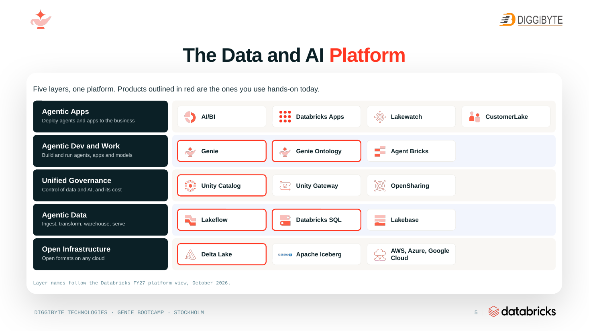
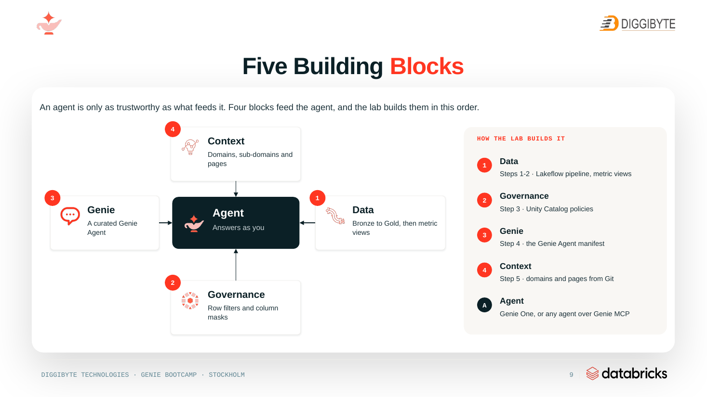
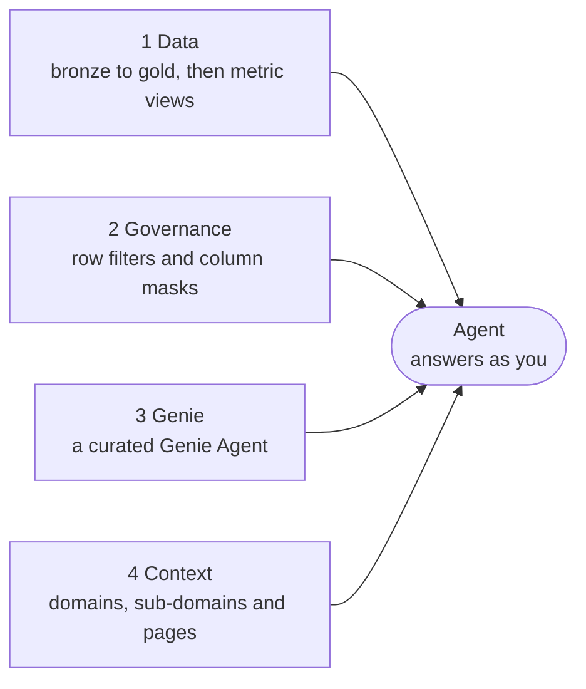
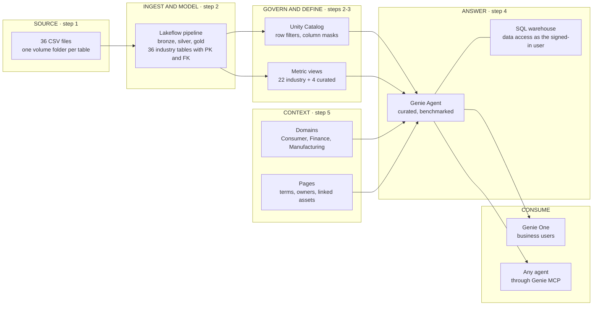
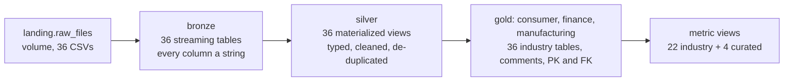
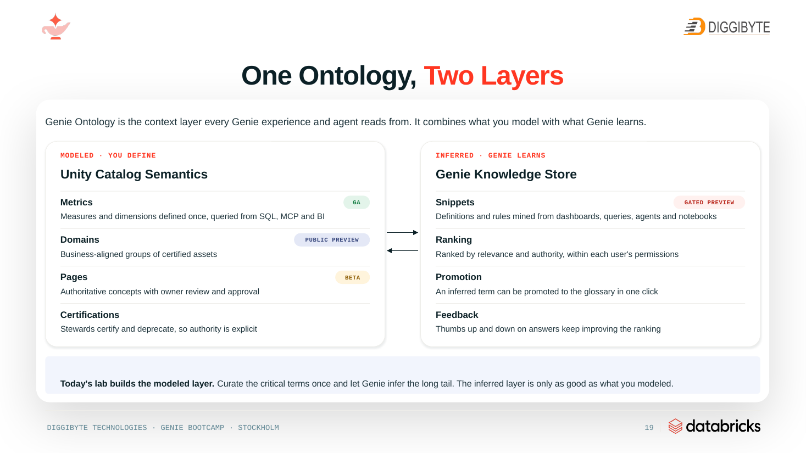

# genie_bootcamp

Material for **"Genie, Governed: From impressive demo to trusted business application"**, Diggibyte,
Stockholm, 29 October 2026. In a two-hour hands-on lab, participants build one trusted **Genie Agent** on a
governed lakehouse. It covers data, governance, Genie curation and business context, on the Databricks
*Lakehouse Industry Data Model, Consumer Goods v2 (MVM)* with synthetic data for the fictional company
Fjällmark Consumer Goods AB.

**Participants: start with [`bootcamp/README.md`](bootcamp/README.md).**
The session deck is in [`bootcamp/slides/`](bootcamp/slides/Databricks-Genie-bootcamp-diggibyte-stockholm.pptx).

## Architecture

The diagrams below come from the session deck. The slide images are exported from the deck. The Mermaid
diagrams redraw the deck's flow slides with this repository's names and numbers.

> The deck's use-case slides (8, 10, 12-16 and 20) still show the earlier Maison Europa example. The lab in this
> repository runs on Fjällmark Consumer Goods and the industry data model, as described below.

### The Data and AI platform

Five layers, one platform. The products outlined in red are the ones used hands-on in the lab.



### Four building blocks feed the agent

An agent is only as trustworthy as what feeds it. Four blocks feed the agent, and the lab builds them in this
order.





| block | lab step | what is built | where in the repo |
|---|---|---|---|
| 1 Data | steps 1-2 | Catalog, volume and CSVs; Lakeflow pipeline bronze, silver, gold; metric views | [`notebooks/01_setup_catalog.py`](bootcamp/notebooks/01_setup_catalog.py), [`pipeline/`](bootcamp/pipeline/), [`metric_views/`](bootcamp/metric_views/), [`databricks.yml`](bootcamp/databricks.yml) |
| 2 Governance | step 3 | Unity Catalog row filters by company code, column masks on shopper PII | [`notebooks/03_governance.py`](bootcamp/notebooks/03_governance.py) |
| 3 Genie | step 4 | The Genie Agent, kept as a manifest in the repo, with benchmarks | [`genie/`](bootcamp/genie/), [`notebooks/04_genie_agent.py`](bootcamp/notebooks/04_genie_agent.py) |
| 4 Context | step 5 | Domains, sub-domains and Pages from Git, GitHub MCP in Agent mode | [`context/`](bootcamp/context/), [`notebooks/05_business_context.py`](bootcamp/notebooks/05_business_context.py) |
| Agent | - | Genie One, or any agent through Genie MCP | - |

### How it fits together

One pipeline, one agent, many answers. What each person sees is decided by Unity Catalog at query time, not by
the agent.



The lab builds context (step 5) after the Genie Agent (step 4), but in the answer path context comes first: the
agent reads it to choose the right definition.

### Inside step 2: the lakehouse



| layer | what happens |
|---|---|
| bronze | Every column kept as a string, plus the source file and the ingest time for lineage |
| silver | Trimmed, typed and de-duplicated; dates in two formats parsed; enum values in the wrong case mapped to the model's values; rows without a key dropped by expectations |
| gold | The exact tables of the industry data model, with column comments written for Genie and PK/FK constraints |
| metric views | 22 industry metric views, plus 4 curated ones that hold the business definitions: `consumer.dtc_sales_metrics`, `finance.net_revenue_metrics`, `finance.receivables_metrics`, `manufacturing.production_performance_metrics` |

### One ontology, two layers

Genie Ontology is the context layer every Genie experience and agent reads from. It combines what you model with
what Genie learns. The lab builds the modeled layer.



### How Genie answers

Anna Svensson, sales analyst Sweden (mapped to company code SE01), asks "What was our net revenue last
quarter?".

```mermaid
sequenceDiagram
    actor Anna as Anna (SE01)
    participant Genie as Genie One / Genie Agent
    participant Ctx as Context (Pages)
    participant MV as finance.net_revenue_metrics
    participant UC as Unity Catalog
    Anna->>Genie: 1 Ask "What was our net revenue last quarter?"
    Genie->>Ctx: 2 Retrieve context: the Net Revenue page (finance definition, EUR group currency)
    Genie->>MV: 3 Calculate with the curated metric view
    MV->>UC: 4 Enforce: row filter keeps SE01 rows only
    UC-->>Genie: governed result
    Genie-->>Anna: 5 Answer for SE01; the Group CFO (ALL) gets every entity
```

Two answers, both right. Context makes the definition the same for everyone; governance makes the scope
different.

## What is where

| folder | for | contents |
|---|---|---|
| [`bootcamp/`](bootcamp/README.md) | **participants** | Self-contained lab folder with its own bundle (`databricks.yml`). Covers 3 domains (consumer, finance, manufacturing; 36 tables). Includes the data, the bronze/silver/gold pipeline, 22 industry and 4 curated metric views, model tags, and notebooks for setup, governance, the Genie Agent, business context and cleanup. Also holds the Genie Agent template, the business glossary (`context/`), the lab guide ([README](bootcamp/README.md)), the [instructor guide](bootcamp/INSTRUCTOR.md) and the session deck ([`slides/`](bootcamp/slides/)). |
| [`full_model/`](full_model/README.md) | instructors, further work | The complete model (10 domains, 116 tables, 733 foreign keys, 79 metric views) with its own bundle. It reuses the bootcamp CSVs, so every CSV is stored once. |
| [`tools/`](tools/) | maintainers | Generators and checkers, Python standard library only. `generate_lakehouse.py` builds the pipeline SQL, metric views and tags. `generate_data.py` and `verify_data.py` build and check the data. `build_genie_template.py` builds the Genie Agent template, and `check_context.py` checks the glossary. Also holds the vendored model in `model/`. |
| `archive/` | history | the earlier v1 material (Maison Europa); not used by the bootcamp |

## Quick start

1. In the Databricks workspace, click **Workspace** > **Create** > **Git folder** and clone
   `https://github.com/dediggibyte/genie_bootcamp`.
2. Follow [`bootcamp/README.md`](bootcamp/README.md):
   * notebook 01 sets up the catalog,
   * the bundle deploys the pipeline (`bootcamp/databricks.yml` > **Deployments** > `dev` > **Deploy** > run
     `cpg_lakehouse_job`; CLI fallback in the README's step 2),
   * notebook 03 adds governance,
   * notebook 04 creates the Genie Agent,
   * notebook 05 adds the business context.

## Maintainers

```bash
# from the repository root (Python 3.10+, no dependencies)
python3 -I tools/generate_lakehouse.py --check   # generated pipeline SQL, metric views and tags are up to date
python3 -I tools/generate_data.py                # regenerate the CSVs, manifests and data READMEs (deterministic)
python3 -I tools/verify_data.py                  # data checks and storyline KPIs
python3 -I tools/build_genie_template.py --check # Genie Agent template is up to date
python3 -I tools/check_context.py                # business glossary references the model correctly
```

Generated files must not be edited by hand: change the generator and run it again.

## Attribution and license

The data model, meaning the tables, columns, keys, tags and industry metric views, comes from the
**Databricks Lakehouse Industry Data Models**, *Consumer Goods v2, MVM*
([upstream](https://github.com/databricks-industry-solutions/lakehouse-industry-data-models/tree/main/data-models/consumer_goods/v2/mvm)).
It is © Databricks, Inc. and licensed under the **Databricks license**: see
[`tools/model/LICENSE.md`](tools/model/LICENSE.md) and [`tools/model/NOTICE.md`](tools/model/NOTICE.md). Under that
license the material may be used only in connection with the Databricks Services. The vendored model is in
[`tools/model/`](tools/model/), and verbatim copies of its LICENSE and NOTICE are in
[`bootcamp/`](bootcamp/LICENSE.md) and [`full_model/`](full_model/LICENSE.md) (written by
`tools/generate_lakehouse.py`, so each self-contained folder and every bundle deployment carries them).

What carries a notice: the generated SQL files (pipeline, industry metric views) say in their header that they
are generated from the model and modified; the generated JSON files (model tags, both `data/manifest.json`)
carry a `_notice` key; the CSV data, whose tables, columns and value formats follow the model, is described in
`data/README.md` of each folder; the business-context domain and subdomain files (`bootcamp/context/domains/`),
which quote some model descriptions, carry a `license` line in their front matter and a footer. The Genie
Agent template carries a `_license` key and the curated metric views a header notice (both are written for this
bootcamp on top of the model's tables). The notebooks and glossary pages are original bootcamp material.

All company names, people, brands, plants, customers and figures are fictional and synthetic. E-mail addresses
use the reserved `example.com` domain.
