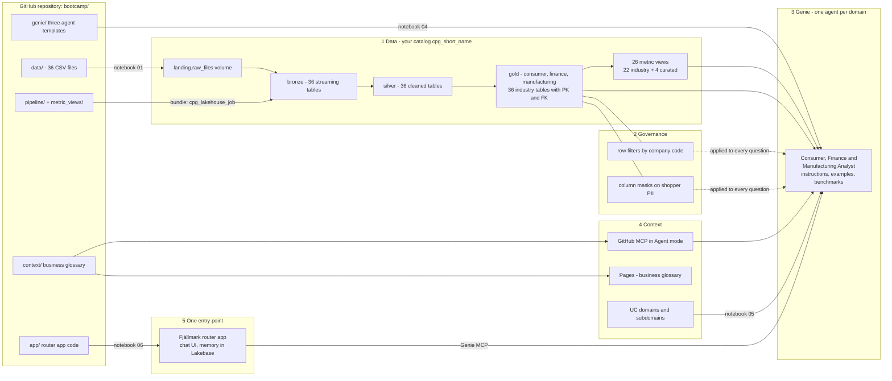

# Genie, Governed: hands-on lab

**From impressive demo to trusted business application.** Diggibyte, Kungsgatan 60, Stockholm, 29 October 2026.
Hands-on lab 15:35-17:35. Speakers: Nivethan Venkatachalam (Databricks MVP) and Kashif Ahmed (Databricks
Solutions Architect Champion).

In this lab you build **three Genie Agents**, one per business domain - the *Fjällmark Consumer Analyst*, *Finance
Analyst* and *Manufacturing Analyst* - put **one chat entry point** in front of them (a custom agent deployed as a
Databricks App), and you prove that the answers can be trusted. Everything you need is in this `bootcamp/` folder:
data, pipeline, metric views, governance, the agent templates, the app and the business context. The company is
fictional and all data is synthetic.

* **The company:** Fjällmark Consumer Goods AB (HQ Stockholm). It sells Nordic foods, beverages and personal
  care through six legal entities, four plants and a webshop. The group currency is EUR. Data runs from
  January 2024 to September 2026.
* **The data model:** three domains of the Databricks *Lakehouse Industry Data Model, Consumer Goods v2 (MVM)*:
  **consumer**, **finance** and **manufacturing**. That is 36 gold tables with the exact industry names,
  123 foreign keys, 22 industry metric views and 4 curated metric views.
* **What you build:** your own catalog, a governed lakehouse, three curated domain Genie Agents with benchmark
  test suites, business context in Unity Catalog, and a router app that answers across the three domains.

> Instructors: see [INSTRUCTOR.md](INSTRUCTOR.md) for the pre-event checklist, recovery checkpoints and the
> demo scripts. The session deck is [`slides/Databricks-Genie-bootcamp-diggibyte-stockholm.pptx`](slides/Databricks-Genie-bootcamp-diggibyte-stockholm.pptx).

---

## Contents

* [Prerequisites](#prerequisites)
* [Architecture](#architecture)
* [Schedule](#schedule)
* [Step 0: Add the repository as a Git folder](#step-0-add-the-repository-as-a-git-folder-10-min)
* [Step 1: Set up your catalog](#step-1-set-up-your-catalog-5-min)
* [Step 2: Deploy and run the lakehouse bundle](#step-2-deploy-and-run-the-lakehouse-bundle-20-min)
* [Step 3: Governance](#step-3-governance-25-min)
* [Step 4: The Genie Agents](#step-4-the-genie-agents-25-min)
* [Step 5: Business context](#step-5-business-context-10-min)
* [Step 6: One entry point - the router app](#step-6-one-entry-point---the-router-app-15-min)
* [Exercise: bring your own question](#exercise-bring-your-own-question-15-min)
* [Governance checklist for the 17:35 "prove it works" slot](#governance-checklist-for-the-1735-prove-it-works-slot)
* [Troubleshooting](#troubleshooting)
* [Cleanup](#cleanup-after-the-event)
* [What is in this folder](#what-is-in-this-folder)

---

## Prerequisites

| you need | why | who provides it |
|---|---|---|
| a laptop with a browser, logged in to the event workspace | everything happens in the Databricks UI, no local installs | you |
| a workspace user with **Workspace access** and **Databricks SQL access** | notebooks, SQL warehouse, Genie Agents, MCP tools | instructor |
| **Serverless** compute for notebooks, jobs and pipelines | every notebook and the pipeline run on serverless | instructor (workspace setting) |
| **CAN USE** on a SQL warehouse | Genie Agents run their SQL on a warehouse | instructor (`00_instructor_setup`) |
| your own catalog `cpg_<your short user name>`, or the right to create it | your sandbox, so nobody else writes into it | instructor (pre-created) or you (step 1) |
| read access to the GitHub repository `dediggibyte/genie_bootcamp` | the Git folder (step 0) and the GitHub MCP (step 5) read it | instructor (public repo or credentials) |
| a GitHub account | the GitHub MCP signs in with *your* GitHub account | you |
| **CAN USE** on the bootcamp Lakebase project, and the right to create a Databricks App | the router app of step 6 keeps its conversation memory in your own Lakebase branch | instructor (`00_instructor_setup`) |

Your **short user name** is the part of your login before `@`, in lower case, with every character that is
not a letter or digit replaced by `_`. For example, `jane.doe@example.com` becomes `jane_doe` and the catalog
is `cpg_jane_doe`. Notebook 01 and the bundle compute it the same way, so you never have to type it.

---

## Architecture

A Genie Agent is only as trustworthy as the four things that feed it: **(1) Data**, **(2) Governance**,
**(3) Genie** curation and **(4) Context**. The **(5) router app** is the single entry point on top.



| layer | built by | where it lives |
|---|---|---|
| landing | notebook [01_setup_catalog](notebooks/01_setup_catalog.py) | `/Volumes/<catalog>/landing/raw_files/<domain>/<table>/<table>.csv` |
| bronze, silver, gold | pipeline `cpg_lakehouse_pipeline` ([pipeline/](pipeline/README.md)) | schemas `bronze`, `silver`, `consumer`, `finance`, `manufacturing` |
| metric views | job task `metric_views` ([02a](notebooks/job_tasks/02a_create_metric_views.py)) | inside the gold schemas |
| model tags | job task `model_tags` ([02b](notebooks/job_tasks/02b_apply_model_tags.py)) | `dbx_*` tags on schemas, tables and columns |
| governance | notebook [03_governance](notebooks/03_governance.py) | functions and mapping tables in schema `governance`, policies on gold |
| Genie Agents | notebook [04_genie_agent](notebooks/04_genie_agent.py) | your workspace home folder |
| context | notebook [05_business_context](notebooks/05_business_context.py) + UI | domain tags, Pages, GitHub MCP source |
| router app | notebook [06_router_app](notebooks/06_router_app.py) ([app/](app/README.md)) | Databricks App `router-<short name>`, your Lakebase branch, an MLflow experiment |

---

## Schedule

The lab runs from 15:35 to 17:35. The times below include reading time. The measured run times come from the
test workspace (serverless, fresh catalog).

| time | step | you do | measured run time |
|---|---|---|---|
| 15:35 | [0](#step-0-add-the-repository-as-a-git-folder-10-min) | add the repository as a Git folder | - |
| 15:45 | [1](#step-1-set-up-your-catalog-5-min) | run notebook 01 | ≈ 1 min |
| 15:50 | [2](#step-2-deploy-and-run-the-lakehouse-bundle-20-min) | deploy the bundle, run the job, explore the layers while it runs | ≈ 9 min (first run) |
| 16:10 | [3](#step-3-governance-25-min) | run notebook 03, switch personas, try to break it | ≈ 4-5 min for *Run all* |
| 16:35 | [4](#step-4-the-genie-agents-25-min) | run notebook 04, then test, benchmark and improve the agents in the UI | ≈ 6 min for *Run all* |
| 17:00 | [5](#step-5-business-context-10-min) | run notebook 05, attach the GitHub MCP, draft a Page | ≈ 1 min for *Run all* |
| 17:10 | [6](#step-6-one-entry-point---the-router-app-15-min) | run notebook 06, then ask the router app questions across the domains | ≈ 4 min for *Run all*, plus the app's first start |
| 17:25 | [exercise](#exercise-bring-your-own-question-10-min) | bring your own question, then the governance checklist | - |
| 17:35 | [demo slot](#governance-checklist-for-the-1735-prove-it-works-slot) | "prove it works" | - |

If you fall behind, keep going: every step can be re-run and only adds what is missing. Ask an instructor
for a recovery checkpoint.

---

## Step 0: Add the repository as a Git folder (10 min)

A **Git folder** is a clone of a Git repository inside your workspace. The notebooks find the data, SQL and
templates next to themselves, so they must run from this Git folder.

**Visibility and access.** Your instructor tells you which case applies:

* **Public repository:** everyone can read it, and the clone below is all you need.
* **Private repository:** you need read access on GitHub *and* a Git credential in Databricks **before you create
  the Git folder** (item 2 below), or the clone fails.
  Click your user icon > **Settings** > **Linked accounts** > **Add Git credential**, set the provider to
  **GitHub**, then either choose **Link Git account** (the Databricks GitHub app, recommended) or paste a GitHub
  personal access token. A classic token needs the `repo` scope; for a fine-grained token, the Databricks
  documentation asks for **Contents: Read and write**.

1. In the left sidebar, click **Workspace** and open your home folder (`Users/<your e-mail>`).
2. Click **Create** > **Git folder**.
3. In the **Create Git folder** dialog:
   * **Git repository URL**: `https://github.com/dediggibyte/genie_bootcamp`
   * **Git provider**: GitHub
   * **Git folder name**: keep `genie_bootcamp`
4. Click **Create Git folder**. You now have `.../genie_bootcamp/bootcamp/`, and that is the only folder you need.

> The repository also feeds the GitHub MCP in step 5. A *private* repository needs extra setup there (the
> Databricks GitHub connector app). The instructor takes care of it.

---

## Step 1: Set up your catalog (5 min)

Open [`notebooks/01_setup_catalog.py`](notebooks/01_setup_catalog.py) in your Git folder, attach **Serverless**
and click **Run all**. Keep the widget defaults.

| widget | default | meaning |
|---|---|---|
| `catalog` | blank = `cpg_<your short user name>` | the catalog for everything in the lab |
| `managed_location` | blank | storage path for a *new* catalog; only if your instructor gives you one |
| `overwrite` | `false` | repairs only; leave it as is |

The notebook:

1. works out your catalog name,
2. finds the `bootcamp/` folder (the one with `databricks.yml`),
3. reuses your catalog, or creates it,
4. creates the schemas `landing`, `bronze`, `silver`, `consumer`, `finance`, `manufacturing` and `governance`,
5. creates the volume `landing.raw_files`,
6. copies the 36 CSV files into the volume, one folder per table,
7. verifies every file.

**Expected result:** "36 CSV files verified" and the next-step instructions.

**If the catalog cannot be created:** on workspaces that use *Default Storage*, `CREATE CATALOG` from a
notebook needs a managed location. The notebook then stops and prints the UI steps: **Catalog** (left
sidebar) > **+** > **Create a catalog** > name `cpg_<your short user name>`, keep the default storage >
**Create**. Then run the notebook again.

🔁 **Load once:** a second *Run all* copies nothing (it reports "36 already present"). Your catalog, schemas,
volume and files are kept as they are.

---

## Step 2: Deploy and run the lakehouse bundle (20 min)

The pipeline and its job are defined as code in [`databricks.yml`](databricks.yml) and [`resources/`](resources/).
Together they are a **Declarative Automation Bundle** (formerly *Databricks Asset Bundle*). You deploy it from
the workspace UI:

1. In your Git folder, open `bootcamp` and click **`databricks.yml`**.
2. Click the **deployments** icon (the rocket) in the left pane of the editor.
3. In the **Deployments** pane, choose the target **`dev`** and click **Deploy**. Review the details in the
   confirmation dialog and click **Deploy** again. The status appears in the **Project output** window.
4. In the **Bundle resources** pane, click the run (▶) icon next to the job **`cpg_lakehouse_job`**.

The bundle's catalog defaults to `cpg_<your short user name>`, the same as notebook 01. If you used a
**different catalog** in step 1, change `variables.catalog.default` in `databricks.yml` before you deploy.

> **Not rehearsed yet:** the clicks above follow the Databricks documentation, but on the test workspace the
> bundle was deployed with the CLI only. If the deployments icon, the **Deployments** pane or the run button look
> different, or the UI deploy fails, use the **CLI fallback**. The CLI path is the one that was tested:
>
> * open a **Web Terminal** (a notebook attached to Serverless > the terminal icon at the bottom of the notebook),
>   or a terminal on your laptop with the Databricks CLI (v1.0 or later). In the Web Terminal the CLI is
>   pre-installed. If a command asks for authentication, run `databricks auth login --host <workspace URL>`.
> * run, from your Git folder (`/Workspace/Users/<your e-mail>/genie_bootcamp`):
>
>   ```bash
>   cd bootcamp
>   databricks bundle deploy -t dev        # add --var catalog=<name> if you used another catalog in step 1
>   databricks bundle run cpg_lakehouse_job -t dev
>   ```
>
> Deploy as **yourself**: you must own the pipeline and its tables, because step 3 attaches the policies as the
> table owner.

### What the job does

```text
cpg_lakehouse_job
  pipeline       bronze -> silver -> gold                (Lakeflow Spark Declarative Pipeline)
     |
     +-- metric_views   22 industry + 4 curated metric views    (notebook 02a)
     +-- model_tags     2,061 dbx_* tags from the industry model (notebook 02b)
     |
  validate       36 gold tables, keys, row counts, every metric view answers (notebook 02c)
```

| layer | what happens | look at |
|---|---|---|
| **bronze** | Auto Loader reads every CSV once into a streaming table `bronze.<domain>_<table>`. All columns are text, plus `_rescued_data`, `_source_file` and `_ingested_at`. | a bronze table: messy values such as `' Gold'`, `Y`/`N`, `31/12/2025` |
| **silver** | One materialized view per table (`silver.<domain>_<table>`): typed, trimmed, enums normalised, dates parsed, deduplicated by primary key. Expectations drop rows with an empty key or a negative quantity. | the pipeline's data quality metrics; [`pipeline/README.md`](pipeline/README.md) lists every rule |
| **gold** | The **exact industry tables** (`consumer.shopper`, `finance.journal_entry_line`, ...) with column comments, primary keys and foreign keys between the three domains. | Catalog Explorer: comments, keys, lineage |
| **metric views** | Governed KPI definitions in YAML: Net Revenue, gross margin, DSO, OEE, yield, AOV and more. | Catalog Explorer: a metric view's definition |
| **model tags** | The model's `dbx_*` tags, such as `dbx_pii_email` and `dbx_subdomain`. | Catalog Explorer: a table's tags |

The raw data contains **deliberate data-quality problems** (duplicates, wrong case, mixed date formats, mixed
booleans, empty keys). [`data/README.md`](data/README.md) documents each one and the silver rule that fixes it.

### What to expect on the first run

* The first run of a fresh catalog takes **about 9 minutes** (measured: 524 s). The `pipeline` task takes about
  6 minutes, `metric_views` and `model_tags` about 2 minutes together, and `validate` about 1 minute.
* **The pipeline page shows one update "FAILED unexpectedly", followed by an automatic retry that completes.
  This is expected, and the job stays green.** The first update loads *all* the data. Lakeflow cannot register
  36 primary keys and 123 foreign keys on brand-new tables in that same update, so the pipeline retries itself
  (*Retry on failure*, inside the same job run). The retry reads no files and loads nothing: in the measured run
  its event log shows all 72 silver and gold materialized views `NO_OP` (about 2.5 minutes, mostly start-up and
  planning), and it registers the 36 primary keys and 123 foreign keys. Details: [`pipeline/README.md`](pipeline/README.md).
* **Never click *Full refresh*.** It would reload everything and gains nothing.

### Where to look while it runs

* **Job run:** **Jobs & Pipelines** > `[dev <short name>] cpg_lakehouse_job (<catalog>)` > the running run.
  You see the four tasks and their state.
* **Pipeline graph:** **Jobs & Pipelines** > `[dev <short name>] cpg_lakehouse_pipeline (<catalog>)`. The
  graph shows 108 datasets (36 bronze, 36 silver, 36 gold). Select a silver table to see its expectations
  and how many rows they dropped.
* **Catalog Explorer:** **Catalog** > your catalog > `finance` > `journal_entry_line`. Look at the column
  comments, the primary and foreign keys, the tags and the lineage graph.
* **SQL editor:** after the job is green, run (replace `<catalog>`):

  ```sql
  -- every layer, by object type (hidden pipeline tables filtered out)
  SELECT table_schema, table_type, count(*) AS objects
  FROM <catalog>.information_schema.tables
  WHERE table_schema IN ('bronze', 'silver', 'consumer', 'finance', 'manufacturing')
    AND table_name NOT LIKE '\_\_%' AND table_name NOT LIKE 'event_log%'
  GROUP BY ALL ORDER BY ALL;
  -- expected: bronze 36 STREAMING_TABLE, silver 36 MATERIALIZED_VIEW,
  --           consumer 12 + 9 METRIC_VIEW, finance 13 + 10, manufacturing 11 + 7

  -- the keys of the industry model
  SELECT constraint_type, count(*) AS constraints
  FROM <catalog>.information_schema.table_constraints
  WHERE table_schema IN ('consumer', 'finance', 'manufacturing')
  GROUP BY ALL;
  -- expected: PRIMARY KEY 36, FOREIGN KEY 123
  ```

🔁 **Load once:** running the job again loads nothing. The pipeline reads no new files and leaves bronze and
silver untouched, and the metric view and tag tasks report "unchanged" and "0 statements". Before step 3 a re-run
takes about 4 minutes (measured: 247 s, all 72 materialized views `NO_OP`), mostly serverless start-up.
**After step 3** (governance), every job run recomputes **11 of the 36 gold tables** from silver: the gold
queries that point at the masked `consumer.shopper` (or the filtered `dtc_order` / `ar_invoice`) to set the build
order cannot be refreshed incrementally while a row filter or mask is attached. That is a rebuild of the same rows
from silver, not a reload: no file is read and silver stays `NO_OP` (measured: pipeline task 174-182 s, whole job
276-283 s). `validate` stays green, because it counts the ungoverned silver tables.

---

## Step 3: Governance (25 min)

Right now everyone who can read your gold tables sees **every** legal entity and **every** shopper's name,
e-mail and phone number. You change that once, in Unity Catalog, and every consumer inherits it: SQL,
dashboards, metric views and your Genie Agent.

Open [`notebooks/03_governance.py`](notebooks/03_governance.py), keep the defaults and click **Run all**
(about 4-5 minutes).

| widget | default | meaning |
|---|---|---|
| `catalog` | blank = `cpg_<short name>` | your catalog |
| `user_email` | your login | whose access you configure |
| `company_code` | `SE01` | the company codes that user may see: `SE01`, `SE01,NO01` or `ALL` |
| `pii_access` | `false` | `true` = may read shopper PII in clear text |
| `buddy_email` | blank | optional: a colleague who tests as a different user |
| `advanced_abac` | `false` | optional: tag-driven masking with `CREATE POLICY` |
| `rollback` | `false` | **leave it `false`** during the lab, or your policies are removed again at the end |

**What the notebook builds**

* **Mapping tables** in schema `governance`: *who may see what* is data, not code
  (`user_company_access`, `pii_readers`).
* **Row filters** on `finance.ar_invoice`, `finance.journal_entry_line`, `consumer.dtc_order` and
  `consumer.dtc_order_line`. Order lines follow their order.
* **Column masks** on six `consumer.shopper` columns: `given_name`, `family_name`, `display_name`,
  `primary_email`, `primary_phone` and `birth_date`. The e-mail keeps its domain (`a***@example.com`), and the
  birth date becomes 1 January of the birth year.
* The policies are attached with `ALTER MATERIALIZED VIEW ... SET ROW FILTER / SET MASK`, because gold tables
  are materialized views owned by the pipeline. They survive pipeline refreshes.

**Personas.** Nobody can log in as these fictional users. In section 10 you *become* each one by copying its
mapping to your e-mail. The effect shows in the very next query, with no pipeline run.

| persona | company codes | PII | typical question |
|---|---|---|---|
| Anna Svensson, sales analyst Sweden | SE01 | no | Swedish webshop sales |
| Lukas Becker, financial controller Germany | DE01 | no | the overdue German receivables |
| Group CFO | ALL | no | every entity, but no customer PII |
| CRM manager Nordics | SE01, NO01, DK01 | yes | contacting loyalty members |

**Try to break it (section 12).**

| # | attempt | what happens | lesson |
|---|---|---|---|
| A | copy the table with `CREATE TABLE ... AS SELECT` | the copy contains only what you can see, but it has **no** policy | give consumers `SELECT` on gold, never `CREATE` |
| B | query **silver** instead of gold | you see everything | silver is not governed: consumers get access to gold only |
| C | filter on a masked value, or ask for another company directly | 0 rows, no error | hidden rows do not exist for you |
| D | (engineer) let a policy read another governed table | `UNSUPPORTED_NESTED_ROW_OR_COLUMN_ACCESS_POLICY` | keep lookup tables ungoverned |

Optional: section 13 shares your gold schemas with a buddy (mapped to DE01, no PII; instructions only, not yet
rehearsed with a second user). Section 14 shows ABAC:
a `CREATE POLICY` that masks a column through its governed tag.

**Expected result:** all checks PASS. You see only SE01 rows in the governed tables, and shopper e-mails
look like `n***@example.com`.

🔁 **Re-running is a no-op.** Mapping rows, functions and policies already in place are reported as
`unchanged`. Sections 10 and 12 change things on purpose and restore them right away.

---

## Step 4: The Genie Agents (25 min)

### 4a. Create the agents (notebook)

Open [`notebooks/04_genie_agent.py`](notebooks/04_genie_agent.py) and click **Run all** (about 6 minutes, mostly
the benchmark runs of the three agents, which run at the same time). The notebook reads the three templates in
[`genie/`](genie/README.md), puts in your catalog and creates one agent per domain in your home folder:

| agent | data sources | example SQL | benchmarks |
|---|---|---|---|
| **Fjällmark Consumer Analyst (\<catalog\>)** | 4 consumer metric views (incl. the curated `dtc_sales_metrics`), 7 consumer tables, `finance.company_code` as entity reference | 7 | 8 |
| **Fjällmark Finance Analyst (\<catalog\>)** | `net_revenue_metrics`, `receivables_metrics`, 8 finance tables | 7 | 9 |
| **Fjällmark Manufacturing Analyst (\<catalog\>)** | 4 manufacturing metric views (incl. `production_performance_metrics`), 6 manufacturing tables | 4 | 7 |

Every agent has column settings (synonyms, entity matching on values such as `PL-POZ-L2`, hidden personal and
technical columns), one text instruction (shared rules - company, calendar, currency, privacy, *who answers
what* - plus its domain's business rules), SQL snippets and sample questions. A question that needs two domains
("webshop sales vs finance revenue") belongs to none of them: the router app of step 6 answers it.

The notebook asks test questions through the Conversation API - one of them on purpose to the wrong agent: the
Consumer Analyst should say that revenue is the Finance Analyst's - runs the benchmarks of all three agents and
prints the links.

> **Your answers are governed.** Genie runs every query *as the person who asks*. With the step 3 defaults
> you are Anna (SE01). "Net revenue by company code in 2026" (Finance Analyst) therefore returns one row: SE01,
> 4,614,311 EUR. The CFO would see all six. The expected values in [`genie/README.md`](genie/README.md) are for a
> user who sees all companies. To compare with them, re-run notebook 03 with `company_code = ALL` (only the
> mapping row changes), and switch back to `SE01` for the demo.
>
> **Expect 23 of 24 benchmarks with the SE01 mapping** (Consumer 8/8, Finance 8/9, Manufacturing 7/7). The Finance
> benchmark "How much of DE01's open receivables is overdue, in EUR?" returns an empty result for Anna, because
> the DE01 rows are filtered out. That is governance working as intended, and a score you can explain.

### 4b. Work with the agents (UI)

Open an agent from the links printed in section 4 of the notebook - start with the Finance Analyst.

1. **Try the sample questions** on the chat page. For each answer, open the generated SQL and check three
   things. Does revenue come from `finance.net_revenue_metrics`? Are totals across companies in EUR? Does it
   use the plant and line codes (`FI-TMP`, `PL-POZ-L2`)?
2. **Run the benchmarks:** open the **Benchmarks** tab and click **Run benchmarks**. Then open the
   **Evaluations** tab and click the run in the **Evaluation name** column. Each question is rated **Good**,
   **Bad** or **Manual review needed**.
3. **Diagnose a wrong answer.** Pick a Bad or Manual review needed question, or one of the tricky ones below,
   and compare **Model output** with **Ground truth**. Common causes:

   | trap | question | right answer |
   |---|---|---|
   | S1 revenue definition | "What was our total revenue in 2025?" | finance Net Revenue, 20,814,527 EUR, not the webshop order total incl. VAT |
   | S2 currency | "What was total webshop GMV across all markets in September 2026?" | one EUR total (12,517 EUR), not one row per currency |
   | active shopper | "How many active shoppers did we have in the 12 months to September 2026?" | 1,668 ordering shoppers, not `lifecycle_status` |
   | loyalty groups | "Compare the AOV of Gold and Platinum members with non-members over the last 12 months." | two groups: 59.64 vs 23.09 EUR |

4. **Improve the agent** where the cause is:
   * **Configure** > **Text**: business rules (the text instruction),
   * **Configure** > **Examples**: example SQL with usage guidance, plus **Add** > **Measure**, **Filter**,
     **Field** or **Joins**,
   * **Configure** > **Data**: column descriptions, synonyms and hidden columns.

   Then run the benchmark again. Never paste a benchmark's answer in as an example: benchmarks test the agent,
   they must not teach it the answers.

🔁 **Re-running notebook 04 keeps your UI edits.** Each agent is found by its title. If its template has not
changed, nothing is touched. Only `force_update = true` overwrites the agents with the templates; the `domains`
widget limits a run to some of them (for example `finance`).

**Share an agent (instructions, not yet rehearsed with a second user):** **Share** > add a user or group >
**CAN RUN**. The viewer also needs:

* **CAN USE** on the agent's SQL warehouse,
* `USE CATALOG` on your catalog, and `USE SCHEMA` + `SELECT` on the gold schemas `consumer`, `finance` and
  `manufacturing` (that covers the gold tables and the metric views in them),
* nothing on `bronze`, `silver` or `governance`, and no `EXECUTE` on the policy functions: Unity Catalog runs a
  row filter or column mask with the rights of the table owner (you), so the `dtc_order_line` filter can read
  `silver.consumer_dtc_order` and the mapping tables for the viewer.

Notebook 03, section 13 (`buddy_email`) runs exactly these grants and maps the buddy to DE01. Their answers then
follow *their* row filters and masks. This has not been run with a second, non-admin user on the test workspace
yet: if a viewer gets a permission error instead of filtered rows, tell the instructor which query failed.

---

## Step 5: Business context (10 min)

Tables tell Genie *what the data is*. The business context tells it *what the business means*. Fjällmark keeps
that context as code in [`context/`](context/README.md): one Markdown page per business term, with the
definition, business rules, calculation SQL and pitfalls.

### 5a. File your assets into the domains (notebook)

The instructor has created the account-level **domains** `Consumer`, `Finance` and `Manufacturing` and their
subdomains. A domain *is* a governed tag. Open
[`notebooks/05_business_context.py`](notebooks/05_business_context.py) and click **Run all** (about 1 minute).
The notebook:

* tags your three gold schemas with their domain (`ALTER SCHEMA ... SET TAGS ('Finance')`),
* tags each gold table and metric view with its subdomain (for example `Finance/General Ledger`),
* tags each of your three Genie Agents with its own domain (it finds them by their titles),
* verifies the result in `information_schema`.

Check it in **Discover** > **Domains** > for example *Finance*: your tables are listed there. If the notebook
stops with "governed tags missing", tell the instructor: the domains have not been created yet.

🔁 Re-running sets only missing tags (measured on the test catalog: the first run set 65 tags in 74 s; the re-run
ran 0 statements, 62 objects "already as wanted" (36 tables and 26 metric views), 61 s).

### 5b. Give the agent the glossary: GitHub MCP in Agent mode

1. Open your **Finance Analyst**, open the **Sources** tab and click **Add**. Select the GitHub MCP service
   (`system.ai.github`). (Repeat for the other two agents if you have time.)
2. In the source's **Description**, tell the agent when to use it, for example:
   > Business glossary of Fjällmark Consumer Goods in the GitHub repository `dediggibyte/genie_bootcamp`,
   > folder `bootcamp/context/domains/<domain>/pages/` (index `bootcamp/context/glossary.csv`). Read the
   > matching page before you answer a question that uses a business term, and follow its rules. Read only.
3. **Disable the write tools** of the connector and keep the read tools (search, get file contents).
4. In the chat box, turn on **Agent mode**. In the **Configure** panel, sign in to GitHub. Every tool call
   runs with *your* GitHub permissions.
5. Ask: *"According to our glossary, how is DSO defined, and what is SE01's DSO?"* The agent reads
   `bootcamp/context/domains/finance/pages/dso.md` and then queries `finance.receivables_metrics`.

**Human approval.** Read-only tools (search, fetch, list) run automatically. A **write** tool (create or update
file contents, issues, pull requests) pauses until you choose **Allow once**, **Always allow in this chat** or **Reject**.
That approval is the human in the loop. In this lab, keep the write tools disabled.

MCP tools work only in **Agent mode**, not in Chat mode. Through the API only read tools work.

### 5c. Draft a Page for your own business question

1. **Discover** > **Pages** > **Create page** (or open a domain and create the Page there, so the domain is
   pre-filled).
2. Pick a concept that is not defined yet, such as *Subscription churn rate*, *Gold-member share of DTC sales*
   or *Line changeover loss*.
3. Fill in **Synonyms**, **Description** and the page body. Copy the structure of any file in
   [`context/domains/*/pages/`](context/domains/): definition, business rules, calculation SQL, pitfalls,
   example questions.
4. Add your tables or metric views under **Related assets**, then **Save as draft**. A draft is visible only to
   you (and curators), and Genie One uses it only in *your* conversations.

Never put personal data in a Page. Pages are account-level.

---

## Step 6: One entry point - the router app (15 min)

A business user should not have to know which agent to ask, and some questions need two of them. Open
[`notebooks/06_router_app.py`](notebooks/06_router_app.py) and click **Run all** (about 4 minutes, plus a few
minutes for the app's first start). It deploys a **custom agent as a Databricks App**, built from the Databricks
app template **Custom Agent (Advanced)** ([`agent-openai-advanced`](https://github.com/databricks/app-templates/tree/main/agent-openai-advanced):
OpenAI Agents SDK, chat UI, conversation memory and long-running tasks in Lakebase). The code is in
[`app/`](app/README.md); `app/agent_server/agent.py` is the router.

```text
  you ──► router app ──┬──► Consumer Analyst       (Genie MCP)
          (chat UI,    ├──► Finance Analyst        (Genie MCP)
           memory)     └──► Manufacturing Analyst  (Genie MCP)
```

The notebook:

1. finds your three agents,
2. creates an MLflow experiment for the traces and **your own branch** of the bootcamp Lakebase project (memory),
3. creates the app `router-<short name>` with its resources: the three agents (*Can run*), their SQL warehouse
   (*Can use*), the router model, the experiment and your Lakebase branch,
4. gives the app's **service principal** access to your data like a colleague: `SELECT` on the gold schemas only,
   and **your** company codes in the step 3 mapping table (no PII) - so the app is governed exactly like you,
5. deploys `app/` and prints the app's link.

Open the app and ask:

* *"What was our total revenue in 2025?"* - one analyst (Finance), official Net Revenue in EUR. As SE01: 5,977,382 EUR,
  and the router points out that only SE01 is visible.
* *"Why is webshop revenue higher than the revenue finance reports?"* - two analysts (Consumer + Finance), compared
  in one currency, explained with VAT, shipping, discounts and returns.
* *"What happened on Poznań line PL-POZ-L2 in March 2026, and what did it do to COGS?"* - Manufacturing + Finance.
* A follow-up without context, such as *"And in 2024?"* - the router remembers the conversation (Lakebase).

Every answer ends with a **Sources** line: which analyst answered which part, with definition, period and
currency. In the MLflow experiment (*Traces*) you can follow a conversation through the router and the Genie calls.

---

## Exercise: bring your own question (10 min)

Take a question from *your* business and translate it to Fjällmark.

1. **Map it to the model.** Which domain is it in? Which gold table or metric view holds the answer?
   [`context/glossary.csv`](context/glossary.csv) and the domain pages help.
2. **Ask the agent.** Read the SQL. Is the number right? Check it yourself in the SQL editor against the metric
   view.
3. **If it is wrong, find the missing piece:**

   | missing piece | fix |
   |---|---|
   | the business definition | a draft Page (step 5c), or a rule under **Configure** > **Text** |
   | the query pattern | an example SQL with usage guidance |
   | a business word | a synonym on the column, or a measure or filter snippet |
   | a table | **Configure** > **Data** > **Add** (the agent allows at most 50 data sources) |

4. **Lock it in:** add your question as a **benchmark** with a checked **SQL Answer**, then run the benchmarks
   again. Now the agent has a test that catches it if it ever regresses.

---

## Governance checklist for the 17:35 "prove it works" slot

Tick these before 17:35. In the demo slot the speakers ask a few of you to show them live.

- [ ] **Data:** job `cpg_lakehouse_job` is green; task `validate` reports 36 of 36 row counts matching
      `data/manifest.json`.
- [ ] **Row filters:** `SELECT table_name, filter_name FROM <catalog>.information_schema.row_filters` lists
      `ar_invoice`, `journal_entry_line`, `dtc_order` and `dtc_order_line`.
- [ ] **Column masks:** `SELECT table_name, column_name, mask_name FROM <catalog>.information_schema.column_masks`
      lists the six `shopper` columns.
- [ ] **You are not an admin:** `SELECT current_user(), is_account_group_member('cpg_bootcamp_admins')` returns
      `false` (members of that group bypass the lab policies).
- [ ] **Governed answer:** the agent's "net revenue by company code in 2026" shows only your company codes
      (SE01: 4,614,311 EUR).
- [ ] **PII:** asking the agent for shopper e-mails gets a refusal or an aggregate answer, never clear text.
- [ ] **Persona switch:** changing your mapping in notebook 03 (section 10) changes the agent's next answer,
      with no pipeline run and no agent change.
- [ ] **Benchmarks:** the latest evaluation of each agent, with the score you can explain (which questions failed
      and why).
- [ ] **Context:** in Agent mode the agent cites a glossary page. Your schemas appear under **Discover** >
      **Domains**.
- [ ] **One entry point:** the router app answers a cross-domain question with a **Sources** line naming two
      analysts, and shows only your company codes.
- [ ] **No copies:** you did not leave a `CREATE TABLE ... AS SELECT` copy of a governed table behind
      (exercise A drops its own copy).

---

## Troubleshooting

| symptom | cause and fix |
|---|---|
| Notebook 01 stops: "could not be created with SQL" / "Metastore storage root URL does not exist" | Your metastore uses Default Storage. Create the catalog in **Catalog** > **+** > **Create a catalog** (default storage), or enter the `managed_location` your instructor gives you. Then run notebook 01 again. |
| Notebook 01: "databricks.yml not found above this notebook" | The notebook is not inside the Git folder's `bootcamp/` folder. Open it from the Git folder. |
| No **dev** target or no deployments icon | Open `bootcamp/databricks.yml` itself, the one next to `notebooks/` in your Git folder. If it is still missing, use the CLI fallback in step 2. |
| The UI deploy fails, or there is no run button for the job | Use the CLI fallback in step 2 (Web Terminal: `cd bootcamp && databricks bundle deploy -t dev && databricks bundle run cpg_lakehouse_job -t dev`). Tell an instructor what the UI showed. |
| Notebook 01 stops: "contains characters other than ASCII letters, digits and '_'" | Your user name has letters such as å, ä or ö. Type a catalog name such as `cpg_bjorn` into the `catalog` widget of **every** notebook, and set it as `variables.catalog.default` in `databricks.yml` (CLI: `--var catalog=cpg_bjorn`). |
| Deploy works, but the job writes to the wrong catalog | You used a non-default catalog in step 1. Set `variables.catalog.default` in `databricks.yml` and deploy again. |
| The pipeline shows "FAILED unexpectedly" on the first run | Expected (see step 2). The automatic retry finishes it and the job stays green. Do **not** use *Full refresh*. |
| The `pipeline` task itself is red after both attempts | Run the job again (*Run now*). The run is incremental: data that was loaded is not loaded again. If it fails again, call an instructor. |
| `validate` fails on row counts or "differ from data/manifest.json" | `validate` counts the ungoverned **silver** tables, so your row filters from step 3 cannot cause this. A CSV in the volume was changed after the first run, or the pipeline did not finish. Run the job again; if it still fails, ask an instructor. Do not delete tables yourself. |
| `validate` fails: "only N of 123 foreign keys registered" | The pipeline's key-registering retry did not run to the end. Run the job again (*Run now*): the pipeline registers the keys without reloading data. |
| Notebook 03 or 04 stops: tables or metric views missing | The job has not finished. Wait for `cpg_lakehouse_job` to be green, then re-run. |
| You still see all company codes after notebook 03 | You are in `cpg_bootcamp_admins` (admins bypass the policies), `company_code` is `ALL`, or you ran with `rollback = true`. Re-run with the defaults. |
| Notebook 04: no warehouse found / permission denied on the warehouse | Enter a warehouse name or ID in the `warehouse` widget. Ask the instructor for **CAN USE**. |
| Notebook 05 stops: governed tags missing, or no permission to assign a tag | The instructor has not run `00_instructor_setup` (domains, tag `ASSIGN`) yet. Continue with 5b and 5c. |
| GitHub MCP is not offered, or cannot read the repository | You are in Chat mode (switch to **Agent mode**), you have not signed in under **Configure**, or the repository is private without the connector app. Tell the instructor. |
| Notebook 06: "Genie Agents not found" | Run notebook 04 first, with the same catalog. |
| Notebook 06 fails on the Lakebase branch | The instructor's Lakebase project is missing or you lack **CAN USE** on it (`00_instructor_setup`, section 8b). |
| The app shows "App crashed" or 502 right after the deployment | Open the app → **Logs**. "permission ... experiment": the grants were still arriving - re-run notebook 06. Lakebase errors: re-run notebook 06; it re-binds your branch. |
| The router says an analyst is "not available" | The app's service principal cannot open that agent (HTTP 403 in the app's logs). Re-run notebook 06: it re-binds the three agents as app resources. |
| The router's answers contain no rows for your companies | The app's mapping is copied from yours when notebook 06 runs. After you change your mapping in notebook 03, re-run notebook 06 (section 5b). |

**Re-runs load nothing.** Notebook 01 skips existing files. The pipeline reads only new files and never needs a
full refresh (after step 3 it rebuilds 11 gold tables from silver on every run, see step 2). Metric views and tags apply only what is missing or changed. Notebook 03 reports
`unchanged`. Notebook 04 leaves an up-to-date agent alone, and 05 sets only missing tags. When in doubt,
**re-run the step**.

**Permissions at a glance:** **CAN USE** on the warehouse (Genie, SQL editor). You own your catalog (schemas,
functions, policies, tags). `ASSIGN` on the domain tags (notebook 05). `EXECUTE` on `system.ai` (GitHub MCP).
The instructor's `00_instructor_setup` grants all of them.

---

## Cleanup (after the event)

1. Open [`notebooks/99_cleanup.py`](notebooks/99_cleanup.py) and **Run all** once *without* confirmation. It
   lists what it would delete: your three bootcamp Genie Agents, your router app with its Lakebase branch and
   MLflow experiment, the governance policies and your catalog.
2. Type your catalog name into the `confirm` widget and **Run all** again. Trashed agents can be restored from
   the workspace **Trash** for 30 days.
3. Delete the job and the pipeline: in **Jobs & Pipelines**, delete
   `[dev <short name>] cpg_lakehouse_job (<catalog>)` and `[dev <short name>] cpg_lakehouse_pipeline (<catalog>)`.
   From a laptop with the Databricks CLI you can instead run, from the `bootcamp` folder,
   `databricks bundle destroy -t dev --var catalog=<catalog>`.
4. Delete your draft Pages (**Discover** > **Pages**) and, if you no longer need it, the Git folder.

Account-level objects (domains, governed tags, groups, published Pages) belong to the instructor. Notebook 99
never touches them.

---

## What is in this folder

| path | what |
|---|---|
| [`notebooks/01_setup_catalog.py`](notebooks/01_setup_catalog.py) | step 1: catalog, schemas, volume, CSV upload |
| [`databricks.yml`](databricks.yml), [`resources/`](resources/) | step 2: the bundle (target `dev`): pipeline `cpg_lakehouse_pipeline`, job `cpg_lakehouse_job` |
| [`notebooks/job_tasks/`](notebooks/job_tasks/) | the job's notebook tasks: metric views (`02a`), model tags (`02b`), validation (`02c`) |
| [`notebooks/03_governance.py`](notebooks/03_governance.py) | step 3: row filters, column masks, personas, break-it exercises, optional ABAC |
| [`notebooks/04_genie_agent.py`](notebooks/04_genie_agent.py) | step 4: create or update the three Genie Agents, test questions, benchmarks |
| [`notebooks/05_business_context.py`](notebooks/05_business_context.py) | step 5: domain and subdomain tags, GitHub MCP, draft Page |
| [`notebooks/06_router_app.py`](notebooks/06_router_app.py), [`app/`](app/README.md) | step 6: the router app (Databricks App from the template *Custom Agent (Advanced)*) |
| [`notebooks/99_cleanup.py`](notebooks/99_cleanup.py) | after the event: remove your agents, router app, policies and catalog |
| [`instructor/00_instructor_setup.py`](instructor/00_instructor_setup.py) | instructors only, once per event ([INSTRUCTOR.md](INSTRUCTOR.md)) |
| [`data/`](data/README.md) | 36 CSV files, `manifest.json`, data dictionary, storylines S1-S7, data-quality issues |
| [`pipeline/`](pipeline/README.md) | bronze, silver and gold SQL per domain (generated), first-run evidence |
| [`metric_views/industry/`](metric_views/industry/), [`metric_views/curated/`](metric_views/curated/README.md) | 22 generated industry metric views, 4 hand-written curated views |
| [`model_tags/`](model_tags/) | the industry model's `dbx_*` tags (generated) |
| [`genie/`](genie/README.md) | the three Genie Agent templates and the cross-domain benchmarks (generated), source selection, all 25 benchmarks with expected values |
| [`slides/`](slides/) | the session deck (`.pptx`) and slide images used in the repository README |
| [`context/`](context/README.md) | business glossary: company profile, domains, subdomains, 27 Pages, agent instructions |

The complete model with all 10 domains and 116 tables is in [`../full_model/`](../full_model/README.md). The
maintainer tools that generate the pipeline, data, tags and agent templates are in [`../tools/`](../tools/).

**License.** The tables, columns, keys, tags and industry metric views come from the Databricks *Lakehouse Industry
Data Model, Consumer Goods v2 (MVM)* (© Databricks, Inc.), licensed under the Databricks license. See
[`LICENSE.md`](LICENSE.md) and [`NOTICE.md`](NOTICE.md) in this folder (copies of `tools/model/`, written by the
generator so that the folder and every bundle deployment carry them). The generated SQL and JSON files are
modified for this bootcamp and say so in their headers or `_notice` keys; the CSV data is documented in
[`data/README.md`](data/README.md).
