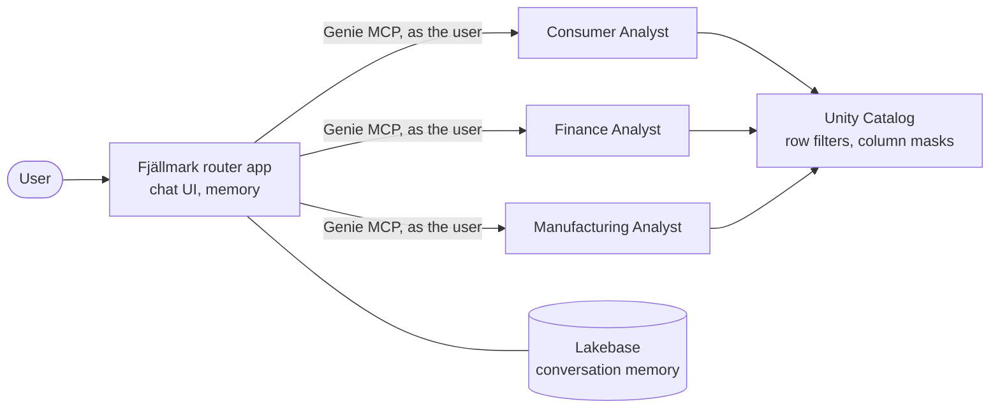

# Fjällmark router app

One chat entry point for the bootcamp's three domain Genie Agents: the *Fjällmark Consumer Analyst*,
*Finance Analyst* and *Manufacturing Analyst* (built by [`../notebooks/04_genie_agent.py`](../notebooks/04_genie_agent.py)).
A business user asks the app; the app decides which analyst owns each part of the question, asks it through the
agent's managed Genie MCP server and combines the answers.



Lab step 6 deploys it: run [`../notebooks/06_router_app.py`](../notebooks/06_router_app.py) from your Git folder.

## What it is built from

The code is the Databricks app template **Custom Agent (Advanced)**
([`agent-openai-advanced`](https://github.com/databricks/app-templates/tree/main/agent-openai-advanced), commit
`382645061cc6`): an OpenAI Agents SDK agent served by MLflow's agent server, with the template's chat UI,
short-term memory and long-running background tasks in Lakebase Postgres. Only the runtime files are kept
(`agent_server/`, `scripts/start_app.py`, `scripts/app_diagnostics.py`).

| file | from the template | changed for the bootcamp |
|---|---|---|
| `agent_server/agent.py` | agent definition | **rewritten**: the router, its instructions, the three Genie MCP servers called as the app's service principal, `thinking: between_tools` for Claude |
| `agent_server/start_server.py`, `utils.py`, `history.py` | unchanged | - |
| `scripts/start_app.py`, `app_diagnostics.py` | unchanged | - (the chat UI `e2e-chatbot-app-next` is cloned at start-up) |
| `app.yaml` | resources and env | Genie, warehouse, model, experiment and Lakebase resources of notebook 06 |
| `pyproject.toml` | dependencies | unchanged dependencies; template dev tooling removed |

## Governance: the app is governed like a user

The router calls the Genie Agents as the **app's service principal** - the template's default identity (its chat
UI calls the agent server without a user token). Unity Catalog governs that principal like any user, and notebook
06 sets it up with least privilege:

| what | granted by notebook 06 |
|---|---|
| Genie | CAN_RUN on the three agents (app resources) |
| compute | CAN_USE on the agents' SQL warehouse (app resource) |
| data | `USE CATALOG`, and `USE SCHEMA` + `SELECT` on `consumer`, `finance`, `manufacturing` only (never `silver`, `governance`) |
| row filters | a row per company code in `governance.user_company_access`, copied from the deploying participant (no row = no governed rows) |
| PII | none: no row in `governance.pii_readers`, so shopper names, e-mails and phones stay masked |
| model, traces, memory | CAN_QUERY on the model, CAN_EDIT on the experiment, CAN_CONNECT_AND_CREATE on its Lakebase branch (app resources) |

With the notebook 03 defaults the app therefore sees SE01 rows and masked shopper data, exactly like the
participant. Everybody who uses the app gets the app's mapping - give a shared app a mapping that suits all its
users.

**Why not on behalf of each user?** Databricks Apps can forward the signed-in user's token (user authorization).
Tested on 2026-10-26: the chat UI does not pass that token on to the agent server, and with a forwarded token
(scopes `genie`, `mcp.genie`, `dashboards.genie`) the managed Genie MCP endpoint answered HTTP 403. Revisit when
user authorization for managed MCP servers is supported.

## Resources (bound by notebook 06)

| resource | what | env var |
|---|---|---|
| `genie-consumer`, `genie-finance`, `genie-manufacturing` | the participant's three Genie Agents (CAN_RUN) | `GENIE_SPACE_CONSUMER`, `GENIE_SPACE_FINANCE`, `GENIE_SPACE_MANUFACTURING` |
| `sql-warehouse` | the SQL warehouse of the agents (CAN_USE) | - |
| `llm-endpoint` | router model, default `databricks-claude-sonnet-5-5` (CAN_QUERY) | `LLM_ENDPOINT` |
| `experiment` | MLflow experiment `/Users/<you>/fjallmark_router_<catalog>` (CAN_EDIT) | `MLFLOW_EXPERIMENT_ID` |
| `postgres` | `databricks_postgres` of the participant's own branch `router-<short name>` of the bootcamp Lakebase project (CAN_CONNECT_AND_CREATE) | `LAKEBASE_AUTOSCALING_ENDPOINT` |

Each participant gets their own **branch** (notebook 06: copy-on-write from `production`, its own compute that
suspends when idle) because the template keeps its tables in the branch's default database `databricks_postgres`
under fixed schemas (`agent_server`, `drizzle`, `agent_memory`): two apps on one branch would collide.

## Evaluating the router

The questions no single Genie Agent can answer - they need two domains - are generated by
`tools/build_genie_template.py` into [`../genie/cross_domain_benchmarks.json`](../genie/cross_domain_benchmarks.json),
with a checked SQL answer each. Ask them in the app and compare with the SQL result (run as the same user).

## Local development

```bash
cd bootcamp/app
uv sync
cat > .env <<'EOF'
DATABRICKS_CONFIG_PROFILE=<profile>
MLFLOW_TRACKING_URI=databricks://<profile>
MLFLOW_EXPERIMENT_ID=<experiment id>
LAKEBASE_AUTOSCALING_PROJECT=fjallmark-genie-bootcamp
LAKEBASE_AUTOSCALING_BRANCH=router-<your short name>
LAKEBASE_AGENT_MEMORY_SCHEMA=agent_memory
GENIE_SPACE_CONSUMER=<space id>
GENIE_SPACE_FINANCE=<space id>
GENIE_SPACE_MANUFACTURING=<space id>
EOF
uv run start-app            # chat UI on http://localhost:3000, agent API on http://localhost:8000/invocations
```

Locally the Genie calls run as the CLI profile's identity (with that identity's row filters).
