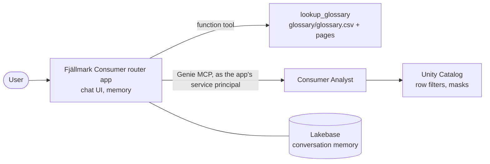

# Fjällmark Consumer router app

One chat entry point for the *Fjällmark Consumer Analyst* Genie Agent of this sample (built by
[`../notebooks/04_genie_agent.py`](../notebooks/04_genie_agent.py)), with the official Consumer glossary as a tool.
A business user asks the app; the app looks the business term up in [`glossary/`](glossary/) (definition, business
rules, reference SQL), asks the analyst for the numbers through its managed Genie MCP server, and names both in
the answer. Questions about other domains are declined with a pointer to the full bootcamp router
([`bootcamp/app/`](../../../bootcamp/app/README.md)).



Step 6 deploys it: run [`../notebooks/06_router_app.py`](../notebooks/06_router_app.py) from your Git folder.

## What it is built from

The bootcamp's router app ([`bootcamp/app/`](../../../bootcamp/app/README.md)), itself the Databricks app template
**Custom Agent (Advanced)** (`agent-openai-advanced`), cut down to one domain:

| file | changed for this sample |
|---|---|
| `agent_server/agent.py` | one Genie MCP server (`GENIE_SPACE_CONSUMER`), single-domain instructions, the `lookup_glossary` function tool |
| `glossary/` | generated by `bootcamp_domain/tools/build_domain_samples.py` from `bootcamp/context/` - do not edit by hand |
| `agent_server/start_server.py`, `utils.py`, `history.py`, `scripts/` | unchanged |
| `app.yaml` | one Genie resource; `CATALOG` comes from notebook 06 |
| `pyproject.toml`, `uv.lock` | unchanged dependencies (the glossary tool uses only the standard library) |

`lookup_glossary(term)` searches the term names and synonyms of `glossary/glossary.csv` (case- and
accent-insensitive: exact name first, then a name inside the text, then shared words), returns the page
`glossary/pages/<file>.md` with `<catalog>` replaced by `CATALOG`, and lists all terms when nothing matches.

## Resources and environment (bound by notebook 06)

| resource | what | env var |
|---|---|---|
| `genie-consumer` | your Consumer Analyst (CAN_RUN) | `GENIE_SPACE_CONSUMER` |
| `sql-warehouse` | the agent's SQL warehouse (CAN_USE) | - |
| `llm-endpoint` | router model, default `databricks-claude-sonnet-5-5` (CAN_QUERY) | `LLM_ENDPOINT` |
| `experiment` | MLflow experiment `/Users/<you>/fjallmark_consumer_router_<catalog>` (CAN_EDIT) | `MLFLOW_EXPERIMENT_ID` |
| `postgres` | `databricks_postgres` of your branch `con-router-<short name>` of the Lakebase project `fjallmark-consumer-sample` (CAN_CONNECT_AND_CREATE) | `LAKEBASE_AUTOSCALING_ENDPOINT` |
| - | your catalog, passed by notebook 06 as a deployment environment variable | `CATALOG` |

The app is named `con-router-<short name>`. Notebook 06 creates the Lakebase project when it does not exist
(you own it) and gives you your own branch of it.

## Governance: the app is governed like a user

The Genie calls run as the **app's service principal**. Notebook 06 grants it `USE CATALOG`, and `USE SCHEMA` +
`SELECT` on `consumer`, `finance` only (never `landing`, `bronze`, `silver`, `governance`), copies your rows of
`governance.user_company_access` (your company codes) to it, and gives it no row in `governance.pii_readers`: shopper names, e-mails and phones stay masked. Everybody who uses the app gets the app's mapping.

## Try it

*"According to our glossary, what is an active shopper, and how many active shoppers did we have at 2026-09-30?"* - one glossary look-up, one Genie question. Then follow the conversation in the experiment's *Traces*.

## Local development

```bash
cd bootcamp_domain/consumer/app
uv sync
cat > .env <<'EOF'
DATABRICKS_CONFIG_PROFILE=<profile>
MLFLOW_TRACKING_URI=databricks://<profile>
MLFLOW_EXPERIMENT_ID=<experiment id>
LAKEBASE_AUTOSCALING_PROJECT=fjallmark-consumer-sample
LAKEBASE_AUTOSCALING_BRANCH=con-router-<your short name>
LAKEBASE_AGENT_MEMORY_SCHEMA=agent_memory
GENIE_SPACE_CONSUMER=<space id>
CATALOG=<your catalog>
EOF
uv run start-app            # chat UI on http://localhost:3000, agent API on http://localhost:8000/invocations
```

Locally the Genie calls run as the CLI profile's identity (with that identity's row filters).
