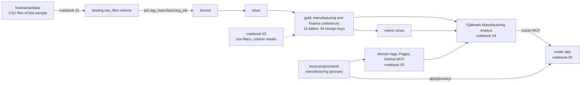

# Genie, Governed: Manufacturing sample

A standalone version of the [bootcamp lab](../../bootcamp/README.md) for **plant, operations and production-controlling teams**: one catalog, one
governed lakehouse, **one Genie Agent** (the *Fjällmark Manufacturing Analyst*), the business context of the Manufacturing domain
and a router app in front of it. The company is the fictional Fjällmark Consumer Goods AB; all data is synthetic.

* **The data:** the `manufacturing` domain of the Databricks *Lakehouse Industry Data Model, Consumer Goods v2 (MVM)*:
  four plants (Lund and Norrköping in Sweden, Tampere in Finland, Poznań in Poland), their production lines, production orders, batches, confirmations and yield plus three **finance reference tables** (`company_code`, `journal_entry`, `journal_entry_line`): the curated `production_performance_metrics` converts each plant's currency to EUR with them.
  14 gold tables (11 manufacturing, 3 finance), 34 foreign keys, 6 industry metric views plus the curated `production_performance_metrics`. Data runs from January 2024 to September 2026.
* **What you build:** your catalog `cpg_manufacturing_<short name>`, the bronze/silver/gold pipeline, row filters and
  column masks for the Manufacturing domain, the Manufacturing Analyst with 7 benchmarks, domain tags and Pages, and a
  router app that combines the business glossary with the analyst's numbers.

> **Not yet run on a workspace.** This sample is built from the tested bootcamp code, but it has not been
> deployed end to end yet: no run times are given, and the first run may surface problems the bootcamp never had.
> Overview of all samples: [`../README.md`](../README.md). Running it as a workshop: [`INSTRUCTOR.md`](INSTRUCTOR.md).

---

## Contents

* [Prerequisites](#prerequisites)
* [Architecture](#architecture)
* [Step 1: Set up your catalog](#step-1-set-up-your-catalog)
* [Step 2: Deploy and run the bundle](#step-2-deploy-and-run-the-bundle)
* [Step 3: Governance](#step-3-governance)
* [Step 4: The Genie Agent](#step-4-the-genie-agent)
* [Step 5: Business context](#step-5-business-context)
* [Step 6: The router app](#step-6-the-router-app)
* [Troubleshooting](#troubleshooting)
* [Cleanup](#cleanup)
* [What is in this folder](#what-is-in-this-folder)

---

## Prerequisites

| you need | why |
|---|---|
| the repository as a **Git folder** in your workspace (bootcamp README, step 0) | the notebooks read the CSV files from `bootcamp/data/` in the same Git folder |
| **Serverless** compute for notebooks, jobs and pipelines | every notebook, the pipeline and the job run on serverless |
| **CAN USE** on a SQL warehouse | the Genie Agent runs its SQL there |
| your own catalog `cpg_manufacturing_<short name>`, or the right to create it | your sandbox |
| the governed tag (domain) **Manufacturing** and `ASSIGN` on it | step 5 only; the instructor's [`instructor/00_instructor_setup.py`](instructor/00_instructor_setup.py) creates it |
| the right to create a Lakebase project and a Databricks App | step 6: the router app keeps its conversation memory in Lakebase |
| a GitHub account | step 5: the GitHub MCP signs in with *your* account |

Your **short user name** is the part of your login before `@`, in lower case, with every character that is not a
letter or digit replaced by `_`: `jane.doe@example.com` becomes `jane_doe`, and the catalog is `cpg_manufacturing_jane_doe`.
Every notebook and the bundle compute it the same way.

---

## Architecture



| layer | built by | where it lives |
|---|---|---|
| landing | [`notebooks/01_setup_catalog.py`](notebooks/01_setup_catalog.py) | `/Volumes/<catalog>/landing/raw_files/<domain>/<table>/<table>.csv` |
| bronze, silver, gold | pipeline `cpg_manufacturing_pipeline` ([`pipeline/`](pipeline/)) | schemas `bronze`, `silver`, `manufacturing` and `finance` (reference) |
| metric views, model tags | job tasks [`02a`](notebooks/job_tasks/02a_create_metric_views.py), [`02b`](notebooks/job_tasks/02b_apply_model_tags.py) | in the gold schema; `dbx_*` tags |
| governance | [`notebooks/03_governance.py`](notebooks/03_governance.py) | functions and mapping tables in schema `governance`, policies on gold |
| Genie Agent | [`notebooks/04_genie_agent.py`](notebooks/04_genie_agent.py) | your workspace home folder |
| context | [`notebooks/05_business_context.py`](notebooks/05_business_context.py) + UI | domain tags, Pages, GitHub MCP source |
| router app | [`notebooks/06_router_app.py`](notebooks/06_router_app.py) ([`app/`](app/README.md)) | Databricks App `mfg-router-<short name>`, a branch of the Lakebase project `fjallmark-manufacturing-sample`, an MLflow experiment |

---

## Step 1: Set up your catalog

Open [`notebooks/01_setup_catalog.py`](notebooks/01_setup_catalog.py) **in your Git folder**, attach **Serverless** and
click **Run all**.

| widget | default | meaning |
|---|---|---|
| `catalog` | blank = `cpg_manufacturing_<your short user name>` | the catalog for everything in this sample |
| `managed_location` | blank | storage path for a *new* catalog, only if your metastore needs one |
| `overwrite` | `false` | repairs only |

It creates the catalog (or reuses it), the schemas `landing`, `bronze`, `silver`, `manufacturing` and `finance` and
`governance`, the volume `landing.raw_files`, and copies the sample's 14 CSV files (37,978 rows) from
`bootcamp/data/` into the volume. A volume file that differs from the Git folder is kept and reported as `WARN`.

🔁 A second *Run all* copies nothing.

---

## Step 2: Deploy and run the bundle

1. In your Git folder, open `bootcamp_domain/manufacturing/databricks.yml`.
2. Click the **deployments** icon (the rocket), choose the target **`dev`** and click **Deploy**.
3. In **Bundle resources**, run the job **`cpg_manufacturing_job`**.

CLI alternative (Web Terminal or laptop), from `bootcamp_domain/manufacturing/`:

```bash
databricks bundle deploy -t dev        # add --var catalog=<name> if you used another catalog in step 1
databricks bundle run cpg_manufacturing_job -t dev
```

The job runs `pipeline` (bronze, silver, gold), then `metric_views` and `model_tags` in parallel, then
`validate`. It is set to **performance optimized** serverless, so tasks start in seconds instead of minutes.

**The first run of a fresh catalog** loads all data, and the pipeline update may then end *"FAILED
unexpectedly"* while it registers the 34 foreign keys: Lakeflow registers the keys of brand-new tables only for
small sets. The automatic retry reads no files and registers the keys; the job stays green. **Never click
*Full refresh*.** See the bootcamp's [`pipeline/README.md`](../../bootcamp/pipeline/README.md) for the evidence.

---

## Step 3: Governance

Everyone who can read your gold tables sees the production of **every** plant, every production cost and the names of supervisors and approvers. You change that once, in Unity Catalog, and every consumer inherits it: SQL, metric views, the
Genie Agent and the router app.

Open [`notebooks/03_governance.py`](notebooks/03_governance.py), keep the defaults and click **Run all**.

| widget | default | meaning |
|---|---|---|
| `catalog` | blank = `cpg_manufacturing_<short name>` | your catalog |
| `user_email` | your login | whose access you configure |
| `plant_code` | `SE-LUN` | the plants you may see: `SE-LUN`, `SE-LUN,PL-POZ` or `ALL` (the SAP codes such as `LUND` work too) |
| `cost_access` | `false` | `true` = you may read production costs |
| `pii_access` | `false` | `true` = you may read supervisor names and user ids |
| `abac_tag` | `cost_confidential` | the governed tag the optional ABAC step uses |
| `buddy_email` | blank | optional: a colleague who tests as a different user |
| `advanced_abac` | `false` | optional: tag-driven masking with `CREATE POLICY` |
| `ask_genie` | `false` | `true` = also ask your Genie Agent a governed question (after step 4) |
| `rollback` | `false` | **leave it `false`**, or your policies are removed again |

| policy | on | rule |
|---|---|---|
| row filter | `manufacturing.production_order` (on `plant_code`) | only the plants mapped to you in `governance.user_plant_access` (`ALL` = every plant) |
| row filter | `batch_record`, `yield_record`, `production_confirmation`, `planned_order` (on `manufacturing_facility_id`) | the same plants, through a lookup on the ungoverned silver plant directory |
| column masks | seven cost columns (`production_order.planned_cost` / `actual_cost`, batch, yield and routing costs) | `NULL` unless you are in `governance.cost_readers` |
| column masks | people: `production_supervisor`, `released_by`, `created_by`, BOM `approved_by`, the `*_by_user` columns | masked unless you are in `governance.pii_readers` |

Master data (plants, lines, work centers, equipment, BOMs, routings) is not row-filtered: Genie needs it to
name plants and lines. The plant e-mail (`plant.lund@example.com`) is a functional mailbox, not personal data,
and stays readable.

The policies are attached with `ALTER MATERIALIZED VIEW ... SET ROW FILTER / SET MASK`, because the gold tables
are materialized views owned by the pipeline. *Who may see what* is data in the `governance` mapping tables, not
code.

**Personas.** In the personas step you *become* each one by copying its mapping to your e-mail; the next query
shows the effect, with no pipeline run.

| persona | plants | costs | people data |
|---|---|---|---|
| Johan Lindgren, plant manager Lund | SE-LUN | no | yes |
| Marta Kowalczyk, plant controller Poznań | PL-POZ | yes | no |
| COO | ALL | yes | no |

**Try to break it:** copy a table with `CREATE TABLE ... AS SELECT`, query silver instead of gold, filter on a
hidden value, and let a policy read a governed table. Each attempt shows a lesson the notebook explains.

**Expected result:** all checks PASS. 🔁 Re-running reports `unchanged`.

> Members of the account group `cpg_bootcamp_admins` bypass the policies. Test as a non-admin.

---

## Step 4: The Genie Agent

Open [`notebooks/04_genie_agent.py`](notebooks/04_genie_agent.py) and click **Run all**. It creates the
**Fjällmark Manufacturing Analyst (\<catalog\>)** in your home folder from the template
[`genie/fjallmark_manufacturing_analyst.json`](genie/fjallmark_manufacturing_analyst.json) (the bootcamp's agent, unchanged), asks a
test question through the Conversation API and runs the 7 benchmarks.

| widget | default | meaning |
|---|---|---|
| `catalog` | blank | your catalog |
| `warehouse` | blank = the first serverless warehouse you can use | the agent's SQL warehouse |
| `ask_test_questions` | `true` | ask the test questions |
| `run_benchmarks` | `true` | run the benchmarks |
| `force_update` | `false` | `true` overwrites your UI edits with the template |

**One agent of three.** The template's instructions know that the bootcamp has two more analysts. Questions that
belong to another domain are declined by design in this sample: that is the agent staying in its lane.

**Your answers are governed.** Genie runs every query as the person who asks, so with the step 3 defaults some
benchmarks return only your rows. The expected values in [`bootcamp/genie/README.md`](../../bootcamp/genie/README.md)
are for a user who sees everything.

Then test, benchmark and improve the agent in the UI exactly as in the bootcamp (step 4b).

---

## Step 5: Business context

The glossary of the Manufacturing domain lives in [`bootcamp/context/domains/manufacturing/`](../../bootcamp/context/domains/manufacturing/): one
Markdown page per business term.

1. **Tags (notebook).** [`notebooks/05_business_context.py`](notebooks/05_business_context.py) tags the
   `manufacturing` schema with the domain **Manufacturing**, every table and metric view with its subdomain, and your Genie Agent.
   It needs the governed tag **Manufacturing**: the instructor creates it with
   [`instructor/00_instructor_setup.py`](instructor/00_instructor_setup.py) ([`INSTRUCTOR.md`](INSTRUCTOR.md)), or an
   admin creates it under **Discover** > **Domains**. Without it, the notebook skips the tags and carries
   on. `tag_reference_tables = true` also tags the finance reference tables (when the domain *Finance* exists).
2. **Pages (UI).** There is no API that creates Pages, so the notebook prints a **Bulk import prompt** and a
   checklist of the expected pages. Open **Discover** > **Pages** > **Create page**, open the Genie Code pane,
   choose **Bulk import pages**, attach the two workspace paths the notebook prints and paste the prompt.
3. **GitHub MCP (UI).** On the agent's **Sources** tab, add `system.ai.github`, point it at
   `bootcamp/context/domains/manufacturing/pages/`, turn on **Agent mode** and ask about *OEE*.

---

## Step 6: The router app

Open [`notebooks/06_router_app.py`](notebooks/06_router_app.py) and click **Run all**. It deploys a custom agent as
a Databricks App (from the template *Custom Agent (Advanced)*, code in [`app/`](app/README.md)):

```text
  you ──► router app ──┬──► glossary tool          (app/glossary/: what a term means)
          (chat UI,    └──► Manufacturing Analyst  (Genie MCP: what the number is)
           memory)
```

| widget | default | meaning |
|---|---|---|
| `catalog` | blank | your catalog |
| `app_name` | blank = `mfg-router-<short name>` | the app |
| `llm_endpoint` | blank = the default | the router's model |
| `lakebase_project` | `fjallmark-manufacturing-sample` | created by this notebook if it does not exist (you own it); you get your own branch |

The notebook creates the MLflow experiment, the Lakebase project (if needed) and your branch, the app with its
resources, and gives the app's service principal `SELECT` on the gold schemas plus **your** mapping rows from
step 3, without PII or cost access. The app is governed like you.

Ask the app:

1. *"According to our glossary, how is OEE calculated, and what was the average OEE per plant in 2025?"*
2. *"What does the glossary say about scrap rate, and which production line had the highest scrap rate in 2026?"*
3. *"How many webshop orders did we have in 2025?"* - not manufacturing data: the router declines

Every answer ends with a **Sources** line. Follow a conversation in the MLflow experiment (*Traces*).

---

## Troubleshooting

| symptom | cause and fix |
|---|---|
| Notebook 01: "databricks.yml not found" or `bootcamp/data` missing | Open the notebook from the Git folder, with the whole repository cloned. |
| Notebook 01: the catalog cannot be created | Create it in **Catalog** > **+** > **Create a catalog** (name `cpg_manufacturing_<short name>`), or set `managed_location`. |
| The pipeline shows "FAILED unexpectedly" on the first run | Expected (step 2): the retry registers the keys. Never use *Full refresh*. |
| `validate` fails on row counts or foreign keys | Run the job again; it loads nothing twice. |
| Notebook 03 or 04: tables missing | The job has not finished. Wait until `cpg_manufacturing_job` is green. |
| You still see everything after notebook 03 | You are in `cpg_bootcamp_admins`, you mapped yourself to `ALL`, or `rollback = true`. |
| Notebook 05: governed tags missing | The domain **Manufacturing** does not exist yet (step 5). Pages and MCP still work. |
| Notebook 06 fails on the Lakebase project | You may not create Lakebase projects: ask an admin to create `fjallmark-manufacturing-sample` and give you **CAN USE**, then re-run. |
| The app shows "App crashed" or 502 right after deployment | Open the app's **Logs**; re-run notebook 06 (grants may still have been arriving). |

---

## Cleanup

1. Run [`notebooks/99_cleanup.py`](notebooks/99_cleanup.py) once **without** confirmation: it lists what it would
   delete (your Genie Agent, the router app with your Lakebase branch and MLflow experiment, the policies and your
   catalog).
2. Type your catalog name into `confirm` and **Run all** again. `drop_lakebase_project = true` deletes the whole
   project instead of only your branch (every user's branch in it).
3. Delete the job and the pipeline in **Jobs & Pipelines**, or run `databricks bundle destroy -t dev` from
   `bootcamp_domain/manufacturing/`.

Account-level objects (the domain, governed tags, published Pages) are never touched.

---

## What is in this folder

| path | what | written by |
|---|---|---|
| [`notebooks/`](notebooks/) | steps 1 and 3-6, cleanup, and the job tasks (`job_tasks/`) | hand |
| [`instructor/00_instructor_setup.py`](instructor/00_instructor_setup.py), [`INSTRUCTOR.md`](INSTRUCTOR.md) | admins, once per workshop: runs the bootcamp instructor notebook with this sample's values | hand |
| [`databricks.yml`](databricks.yml), [`resources/`](resources/) | the bundle: pipeline `cpg_manufacturing_pipeline`, job `cpg_manufacturing_job` | hand |
| [`app/`](app/README.md) | the router app; `app/glossary/` is generated | hand |
| [`pipeline/`](pipeline/), [`metric_views/`](metric_views/), [`model_tags/`](model_tags/) | bronze, silver and gold SQL, metric views, `dbx_*` tags | [`../tools/build_domain_samples.py`](../tools/build_domain_samples.py) |
| [`genie/`](genie/) | the Genie Agent template (copy of the bootcamp's) | generated |
| [`data/manifest.json`](data/manifest.json) | row counts of this sample's tables; the CSV files stay in `bootcamp/data/` | generated |
| [`LICENSE.md`](LICENSE.md), [`NOTICE.md`](NOTICE.md) | the industry model's license | generated |

**License.** The tables, columns, keys, tags and industry metric views come from the Databricks *Lakehouse Industry
Data Model, Consumer Goods v2 (MVM)* (© Databricks, Inc.), licensed under the Databricks license; see
[`LICENSE.md`](LICENSE.md) and [`NOTICE.md`](NOTICE.md).
