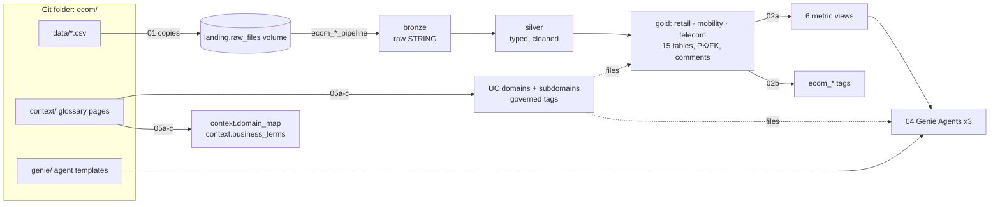

# ecom bootcamp - Nordvik Group: three domains on Databricks, end to end

A self-contained Databricks bootcamp project. It shows how an enterprise organises and analyses its data across
**three business domains**, from raw CSV files to a governed semantic layer, **Genie Agents**, and Unity Catalog
**domains and subdomains** with a business glossary:

| domain | business unit (fictional) | gold schema | subdomains | Genie Agent |
|---|---|---|---|---|
| **Retail and Commerce** | *Nordvik Retail* - 5 stores and a webshop (electronics, fashion, beauty) | `retail` | Product Catalog · Stores and Channels · Customers · Sales and Returns | Nordvik Retail Analyst |
| **Mobility and Automotive** | *Nordvik Mobility* - car dealers with workshops and a truck centre | `mobility` | Vehicle Catalog · Dealer Network · Vehicle Sales · Aftersales Service | Nordvik Mobility Analyst |
| **Telecommunications and Media** | *Nordvik Connect* - mobile, fibre and TV / streaming operator | `telecom` | Plans and Products · Customers and Subscriptions · Billing · Usage | Nordvik Connect Analyst |

> **All data is synthetic.** Nordvik Group, its stores, dealers, customers, orders, invoices and people do not
> exist. Real brand and model names (Apple, H&M, Dior, Volvo, Tesla, Scania, Netflix, Spotify, ...) only describe the
> products, vehicles and streaming add-ons on sale; prices are illustrative. Details: [`data/README.md`](data/README.md).

## Status

| part | status |
|---|---|
| source data, pipelines, metric views, bundle, tags, job tasks (01, 02a-c) | **built** and checked locally (see [Verification](#verification)) |
| Genie Agents (04), business context: domains, subdomains, glossary (05a-c) | **built** and checked locally |
| governance (03), dashboards (06), cleanup (99) | **not built yet** - planned next; manual cleanup is described [below](#7-clean-up) |
| run on a Databricks workspace | **not yet run** - everything above is verified offline only |

## Contents

- [Where is what](#where-is-what)
- [How it fits together](#how-it-fits-together)
- [Before you start](#before-you-start)
- [Step by step](#step-by-step) - 1 setup · 2 pipelines · 3 governance · 4 Genie Agents · 5 domains and business context · 6 dashboards · 7 clean up
- [Example questions and the answers to expect](#example-questions-and-the-answers-to-expect)
- [Tags: apply and review](#tags-apply-and-review)
- [Changing things](#changing-things) · [Verification](#verification) · [Troubleshooting](#troubleshooting)

## Where is what

| path | what it is | used by |
|---|---|---|
| `notebooks/2026-10-27-01-setup-catalog.py` | **Step 1** - catalog, schemas, volume, copies the CSV files, checks them, tags catalog / schemas / volume | you |
| `databricks.yml`, `resources/ecom.pipelines.yml`, `resources/ecom.job.yml` | **Step 2** - the bundle: 3 serverless pipelines (one per domain) and the job `ecom_job` | you (Deploy + Run) |
| `pipeline/<domain>/2026-10-27-01-bronze.sql`, `-02-silver.sql`, `-03-gold.sql` | bronze → silver → gold SQL of each domain (star schema, keys, comments) | the pipelines |
| `metric_views/2026-10-27-<domain>-metrics.sql` | the 6 metric views (KPI definitions in YAML) | job task `metric_views` |
| `notebooks/job_tasks/2026-10-27-02a-create-metric-views.py` | creates / updates the metric views | `ecom_job` |
| `notebooks/job_tasks/2026-10-27-02b-apply-tags.py` | `ecom_*` tags on tables, columns and metric views | `ecom_job` |
| `notebooks/job_tasks/2026-10-27-02c-validate.py` | row counts, keys, metric-view totals vs expected answers, tags | `ecom_job` |
| **`notebooks/2026-10-27-04-genie-agents.py`** | **Step 4 - creates the three Genie Agents**, asks test questions, runs the benchmarks | you |
| `genie/2026-10-27-<domain>-agent.json` | the Genie Agent templates (instructions, example SQL, benchmarks) | notebook 04 |
| **`notebooks/2026-10-27-05a-context-retail.py`**, **`-05b-context-mobility.py`**, **`-05c-context-telecom.py`** | **Step 5 - create the domain and its subdomains**, file schema, tables, metric views and agent into them, write the glossary tables, Pages prompt | you (one per domain) |
| `notebooks/2026-10-27-05-context-common.py` | the shared logic of 05a-c (run through them) | 05a-c |
| `context/<domain>/_domain.md`, `context/<domain>/<subdomain>/_subdomain.md` | the domain and subdomain definitions (name, governed tag, owner, objects) | 05a-c |
| `context/<domain>/pages/2026-10-27-<term>.md`, `context/2026-10-27-glossary.csv` | one page per business term (definition, SQL, reference value) and the index | 05a-c, Pages import, GitHub MCP |
| `config/2026-10-27-tags.json` | every `ecom_*` tag and the table → subdomain assignment | 01, 02b, 05a-c |
| `data/<domain>/2026-10-27-<table>.csv`, `data/2026-10-27-manifest.json`, `data/2026-10-27-expected-answers.json` | 17 source files (< 50 rows each), their manifest, the numbers every check quotes | 01, 02c, generators |
| `tools/2026-10-27-generate-data.py` | generates the data (local, standard library) | maintainers |
| `tools/2026-10-27-build-semantics.py` | generates `context/` **and** `genie/` from one spec (local, standard library) | maintainers |

## How it fits together



Unity Catalog layout of your catalog `ecom_<your short user name>`:

| schema | holds |
|---|---|
| `landing` | volume `raw_files`: `<domain>/<table>/2026-10-27-<table>.csv` |
| `bronze`, `silver` | `<domain>_<table>`: raw text, then typed / cleaned / de-duplicated (silver is **not** governed - consumers get gold only) |
| `retail`, `mobility`, `telecom` | gold star schemas (dimensions `dim_*`, facts `fact_*`) and the metric views |
| `governance` | row-filter / column-mask functions and access mappings (notebook 03, not built yet) |
| `context` | `domain_map` and `business_terms` (notebooks 05a-c) |

The gold model per domain (each pipeline stays at ≤ 6 foreign keys, so its first update registers all keys):

| domain | dimensions | facts | metric views |
|---|---|---|---|
| retail | `dim_product` (brand denormalised), `dim_store`, `dim_customer` | `fact_sales` (completed order lines), `fact_returns` | `sales_metrics`, `return_metrics` |
| mobility | `dim_vehicle_model`, `dim_dealer`, `dim_customer` | `fact_vehicle_sales`, `fact_service_visits` | `vehicle_sales_metrics`, `service_metrics` |
| telecom | `dim_plan`, `dim_customer`, `dim_subscription` | `fact_billing`, `fact_usage` | `billing_metrics`, `usage_metrics` |

## Before you start

* A Databricks workspace with **Unity Catalog** and **serverless** compute (notebooks, jobs, pipelines, SQL warehouse).
* Permission to create a catalog - or a catalog created for you (step 1 explains both).
* **Genie** enabled, and `CAN USE` on a serverless SQL warehouse (step 4).
* For step 5 *creating* the domains: an **account / metastore admin** (creates governed tags and domains once) and the
  **ASSIGN** permission on those governed tags for everyone who files objects into them. Without them, step 5 still
  writes the glossary tables and tells you exactly what is missing.
* The repository as a **Git folder**: Workspace → *Create* → *Git folder* → `https://github.com/dediggibyte/genie_bootcamp`
  (branch `feature/ecom_demo` until it is merged to `main`). Everything runs from the folder `ecom/`.

## Step by step

### 1. Set up the catalog and land the data - notebook 01

Open `ecom/notebooks/2026-10-27-01-setup-catalog.py`, attach **Serverless**, **Run all**.

* Widgets: `catalog` (blank = `ecom_<your short user name>`), `managed_location` (only for a new catalog on
  workspaces that need one), `overwrite` (repairs only).
* It checks that no `ecom_*` tag key is a governed tag, creates the catalog (comment marker `[created by ecom bootcamp]`),
  the 8 schemas and the volume, copies the 17 CSV files, verifies header, row count and size against the manifest, and
  tags catalog, schemas, volume and the notebooks.
* If `CREATE CATALOG` is not allowed (Default Storage), the notebook prints a 30-second UI click-path; create the
  catalog, then run again.

**Expected:** `✅ Setup complete for catalog ecom_...` and a table of 17 files with status `OK`.

### 2. Deploy the bundle and run the pipelines - `ecom_job`

**UI:** open `ecom/databricks.yml` → **Deployments** (rocket icon) → target **dev** → **Deploy** → under *Bundle
resources* run **`ecom_job`**.
**CLI** (from `ecom/`, after `databricks auth login`):

```bash
databricks bundle deploy -t dev            # optionally: --var catalog=<your_catalog>
databricks bundle run ecom_job -t dev
```

The job runs the three domain pipelines **in parallel** (bronze → silver → gold), then `metric_views` →
`tags` → `validate`. It uses `PERFORMANCE_OPTIMIZED` serverless because participants wait for it.

**Expected:** all six tasks green; `validate` ends with `✅ Lakehouse validated: 15 gold tables, 17 foreign keys,
6 metric views, totals match the expected answers`. Re-running the job loads nothing new.

If you used a catalog other than the default, set the same name in `variables.catalog.default` of `databricks.yml`
(or `--var catalog=<name>`).

### 3. Governance - notebook 03 *(not built yet)*

Planned: row filters by store region / dealer region / customer segment and column masks on names, e-mail, phone,
purchase cost and VIN, driven by mapping tables in `governance`, with personas and "try to break it". Steps 4 and 5
work without it; once it exists, Genie answers follow each user's scope automatically.

### 4. Create the Genie Agents - notebook 04

Open **`ecom/notebooks/2026-10-27-04-genie-agents.py`** → **Run all**.

| widget | meaning |
|---|---|
| `catalog` | blank = `ecom_<your short user name>` |
| `warehouse` | SQL warehouse id or name; blank = first serverless warehouse you may use |
| `domains` | `retail,mobility,telecom` (which agents to build) |
| `ask_test_questions`, `run_benchmarks` | ask 4 test questions; run the 18 benchmarks with Genie's evaluation API |
| `force_update` | push the template even if the agent is up to date |

What it does: checks that every data source exists → creates (`POST /api/2.0/genie/spaces`) or updates (`PATCH`) the
agents **Nordvik Retail Analyst (`<catalog>`)**, **Nordvik Mobility Analyst (`<catalog>`)** and **Nordvik Connect
Analyst (`<catalog>`)** in your home folder → tags them `ecom_project` → asks test questions (one deliberately to the
wrong agent) → runs the benchmarks and shows `GOOD / BAD / NEEDS_REVIEW` per question with Genie's SQL next to the
expected SQL. Questions marked ⚠ are tricky on purpose.

Each agent gets its domain's 5 gold tables and 2 metric views, one text instruction (definitions, region codes, who
answers what, privacy), 5 example SQLs on the metric views, SQL snippets, 4 sample questions and 6 benchmarks. Share
an agent with **Can run**; viewers also need `CAN USE` on the warehouse and `SELECT` on the gold schema.

**Expected:** three links "Open ... in Genie" and benchmark scores per agent.

### 5. Create the domains and subdomains, file everything into them - notebooks 05a / 05b / 05c

One notebook per domain: **`2026-10-27-05a-context-retail.py`**, **`-05b-context-mobility.py`**,
**`-05c-context-telecom.py`** (all three run the shared `2026-10-27-05-context-common.py`). Open one → **Run all**;
its widgets appear after the first run.

| widget | meaning |
|---|---|
| `catalog` | blank = `ecom_<your short user name>` |
| `create_domains` | **`true` = create** the governed tags, the domain and its 4 subdomains (admin); `false` (default) = check only |
| `publish_domains` | publish domains this notebook created (otherwise drafts) |
| `action` | `apply` or `remove` this domain's tags |

What each notebook does:

1. Reads the domain from `context/<domain>/_domain.md`, the subdomains from `context/<domain>/<subdomain>/_subdomain.md`
   and the business terms from `context/2026-10-27-glossary.csv`.
2. Writes `context.domain_map` (domain → subdomain → gold object, owner) and `context.business_terms` (term,
   definition, metric view and measure, synonyms, related terms, page).
3. **Creates the domain and subdomains** in Unity Catalog when `create_domains = true` - for each: a value-less
   governed tag (`POST /api/2.1/tag-policies`), the domain (`POST /api/2.0/domains`, subdomains with
   `parent_domain_id`), then publish (`PATCH ...?update_mask=draft`). Existing ones are reused.
4. Files the gold schema into the domain (`ALTER SCHEMA <catalog>.retail SET TAGS ('Nordvik Retail and Commerce')`) and
   every table and metric view into its subdomain (`... SET TAGS ('Nordvik Retail and Commerce/Sales and Returns')`).
5. Files the domain's Genie Agent into the domain (workspace tag assignment on the Genie space).
6. Verifies, and prints the **Pages bulk-import prompt** (Discover → Pages → Create page → Genie Code → *Bulk import
   pages*) and the **GitHub MCP** source description for the agent's Agent mode.

| domain (governed tag) | subdomains (governed tags `<domain>/<subdomain>`) | business terms |
|---|---|---|
| `Nordvik Retail and Commerce` | Product Catalog, Stores and Channels, Customers, Sales and Returns | Net Revenue, Gross Margin, Average Order Value, Return Rate, Return Reason, Sales Region and Channel, Loyalty Tier, Product Category and Brand |
| `Nordvik Mobility and Automotive` | Vehicle Catalog, Dealer Network, Vehicle Sales, Aftersales Service | Vehicles Sold, Vehicle Revenue, EV Share, Powertrain, Dealer and Region, Service Revenue, Warranty Share, Fleet Customer |
| `Nordvik Telecommunications and Media` | Plans and Products, Customers and Subscriptions, Billing, Usage | Billed Revenue, ARPU, Overdue Amount, Active Subscription, Customer Segment, Data Usage, Streaming Hours and Add-ons |

**Typical flow in a class:** the admin runs 05a-c once with `create_domains = true`; then every participant runs them
with the default `false` to file their own catalog's objects and agents. Domains are account-wide and shared.

**Expected:** a results table with `exists` / `created` for the domain and 4 subdomains, `SET OK` / `already tagged`
for the schema and its 7 objects (5 gold tables, 2 metric views), and the agent `tagged`. In the UI: **Discover → Domains
→ Nordvik ...** lists your schema, tables, metric views and agent.

### 6. Dashboards - notebook 06 *(not built yet)*

Planned: one AI/BI dashboard per domain (≤ 7 measures each) on the metric views, published with
`embed_credentials = false` so each viewer sees their own scope.

### 7. Clean up

Notebook 99 is not built yet. Until then, clean up by hand - only your own objects:

1. **Job and pipelines:** from `ecom/`, `databricks bundle destroy -t dev` (or delete them in the UI).
2. **Genie Agents:** in Genie, trash *Nordvik Retail / Mobility / Connect Analyst (`<your catalog>`)*.
3. **Catalog:** `DROP CATALOG ecom_<you> CASCADE` - only if notebook 01 created it (its comment contains
   `[created by ecom bootcamp]`); otherwise drop just the schemas `landing, bronze, silver, retail, mobility, telecom,
   governance, context`.
4. **Domains (admin, after everyone is done):** run 05a-c with `action = remove` to untag, then delete the domains and
   governed tags whose description ends with `[created by ecom bootcamp]` in Discover → Domains and the tag-policy UI.

## Example questions and the answers to expect

For a user who sees every row (values from `data/2026-10-27-expected-answers.json`; these are the agents' benchmarks):

| agent | question | answer |
|---|---|---|
| Nordvik Retail Analyst | What was our total net revenue in the first half of 2026? | **248 606.20 SEK** |
| Nordvik Retail Analyst | What is the average order value in Göteborg? ⚠ | **7 538.34 SEK** |
| Nordvik Retail Analyst | What is our return rate? ⚠ | **22.45 %** |
| Nordvik Retail Analyst | Which brand brought in the most net revenue? | **Samsung** |
| Nordvik Retail Analyst | What is the gross margin percentage for beauty products? | **57.16 %** |
| Nordvik Retail Analyst | How many orders did the webshop take? ⚠ | **6** |
| Nordvik Mobility Analyst | How many vehicles did we sell in the first half of 2026? | **38** |
| Nordvik Mobility Analyst | What share of the trucks we sold were electric? ⚠ | **57.14 %** |
| Nordvik Mobility Analyst | What is the average sale price of a car? ⚠ | **507 161.21 SEK** |
| Nordvik Mobility Analyst | How much service revenue did the Stockholm region earn? | **124 250 SEK** |
| Nordvik Mobility Analyst | What share of workshop visits were warranty work? | **13.64 %** |
| Nordvik Mobility Analyst | Which model sold the most units? | **Toyota Corolla Hybrid** |
| Nordvik Connect Analyst | What was ARPU last month? ⚠ | **468.36 SEK** |
| Nordvik Connect Analyst | How much did we bill in May 2026? | **10 951 SEK** |
| Nordvik Connect Analyst | What is the overdue amount of the May invoices? | **2 293 SEK** |
| Nordvik Connect Analyst | What share of business invoices for June has been paid? | **50 %** |
| Nordvik Connect Analyst | How much data did a subscription use on average in June? ⚠ | **242.20 GB** |
| Nordvik Connect Analyst | How many active subscriptions do we have? ⚠ | **22** |

⚠ = tricky on purpose: "Göteborg" is region GOT, the return rate counts units, webshop orders exclude cancelled ones,
hybrids are not EVs, a car price is not averaged with trucks, ARPU and data per subscription are per month, active
subscriptions come from the subscription status.

## Tags: apply and review

Plain key/value tags with the prefix `ecom_` (no collision with governed tags such as `domain`), all defined in
`config/2026-10-27-tags.json`:

| key | on | values |
|---|---|---|
| `ecom_project` | everything (catalog, schemas, volume, tables, metric views, job, pipelines, notebooks, Genie Agents) | `ecom_bootcamp` |
| `ecom_domain` | domain schemas, tables, metric views, pipelines | `retail_commerce`, `mobility_automotive`, `telecom_media` |
| `ecom_subdomain` | tables and metric views | e.g. `sales_returns`, `aftersales_service`, `billing` |
| `ecom_layer` | catalog, schemas, volume, tables | `landing`, `bronze`, `silver`, `gold`, `semantic`, ... |
| `ecom_table_type` | tables and metric views | `fact`, `dimension`, `metric_view` |
| `ecom_pii` | personal-data columns | `name`, `email`, `phone` |
| `ecom_classification` | sensitive columns (PII, purchase cost, VIN) | `confidential` |

Applied by notebook 01 (catalog, schemas, volume, notebooks), job task `tags` (tables, columns, metric views), the
bundle YAML (job, pipelines) and notebook 04 (Genie Agents). Files inside the volume are not Unity Catalog objects and
cannot be tagged - the volume carries the tags. The **governed** domain / subdomain tags of step 5 come on top.

Review them with SQL:

```sql
-- every tagged table / metric view with its domain and subdomain
SELECT schema_name, table_name, tag_name, tag_value
FROM ecom_<you>.information_schema.table_tags
WHERE tag_name LIKE 'ecom\_%' ORDER BY ALL;

-- every personal-data column
SELECT schema_name, table_name, column_name, tag_value AS pii
FROM ecom_<you>.information_schema.column_tags
WHERE tag_name = 'ecom_pii' ORDER BY ALL;

-- which subdomain owns what, and how a term is defined
SELECT * FROM ecom_<you>.context.domain_map ORDER BY ALL;
SELECT term, definition, metric_view, measure FROM ecom_<you>.context.business_terms WHERE domain = 'Telecommunications and Media';
```

## Changing things

* **Data:** edit `tools/2026-10-27-generate-data.py`, then `python3 -I ecom/tools/2026-10-27-generate-data.py`
  (from the repository root). `--check` exits 1 if a file is stale. The manifest and expected answers follow.
* **Business terms, domains, subdomains, Genie Agents:** edit the spec in `tools/2026-10-27-build-semantics.py`, then
  `python3 -I ecom/tools/2026-10-27-build-semantics.py`. It rewrites `context/` and `genie/` together and validates the
  templates (unique ids, no `SELECT *`, benchmarks not among the examples, every column and measure exists). Then
  re-run notebook 04 (new template version → agents updated in place) and 05a-c.
* **Which table belongs to which subdomain:** `ecom_subdomain` in `config/2026-10-27-tags.json`, then rebuild the
  semantics and re-run the job task `tags` and 05a-c.
* **Pipeline SQL or metric views:** edit, redeploy the bundle, run `ecom_job`. Gold column comments and constraints
  live in the pipeline SQL and cannot be changed afterwards with `ALTER`.

## Verification

Run locally (no workspace needed):

* `python3 -I ecom/tools/2026-10-27-generate-data.py --check` and `python3 -I ecom/tools/2026-10-27-build-semantics.py --check` - nothing stale.
* The silver and gold SQL was **executed** on the CSV files with DuckDB (the only change: Spark's date-parsing function
  mapped to DuckDB's), then every metric-view measure, the 15 Genie example SQLs, the 18 benchmarks and the 23 glossary
  page queries: all column types match the DDL, primary keys are unique, all 17 foreign keys resolve, silver equals the
  manifest, and **every value equals `data/2026-10-27-expected-answers.json`** (257 metric-view values, 18 benchmarks,
  23 page values). Deliberately broken copies (cancelled orders kept, a date format not parsed, hybrids counted as
  EVs) were caught.
* The bundle YAML validates against the Databricks CLI's bundle schema (v0.285); all notebooks compile.

Not verified yet: a run on Databricks (`databricks bundle validate` with a logged-in profile, the job, the Genie and
Domains APIs). The DuckDB run is close to Databricks SQL but not identical.

## Troubleshooting

| symptom | fix |
|---|---|
| notebook 01 stops at `CREATE CATALOG` | create the catalog in Catalog Explorer (the notebook prints the click-path) or enter a `managed_location`, then run again |
| notebook 01: "tag keys are governed tags" | an admin made an `ecom_*` key a governed tag - rename the keys in `config/2026-10-27-tags.json` and `resources/*.yml` |
| job task `validate` fails on foreign keys | run the job again (the pipeline task retries once on a first run) |
| `databricks bundle ...`: "cannot configure default credentials" | `databricks auth login --host <workspace-url>` (or `-p <profile>`) |
| notebook 04: data sources missing | run `ecom_job` first (gold tables and metric views) |
| notebook 04: a benchmark is `BAD` | compare `genie_sql` with `expected_sql`; improve the instruction or examples in the semantics spec and rebuild |
| notebook 05x: governed tag `MISSING` | an admin runs the notebook once with `create_domains = true` |
| notebook 05x: `PERMISSION_DENIED` / ASSIGN on `SET TAGS` | the admin grants you ASSIGN on the domain's governed tags |
| notebook 05x: agent not found | run notebook 04 first (same catalog) |
| Pages / GitHub MCP links give 404 | the links point to `main` - merge `feature/ecom_demo` first |
