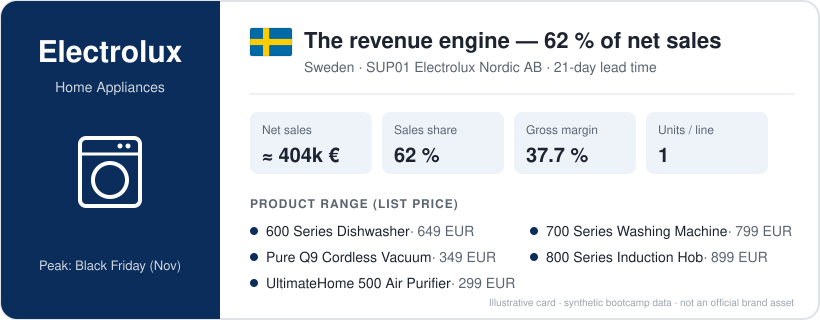
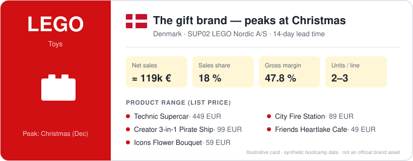
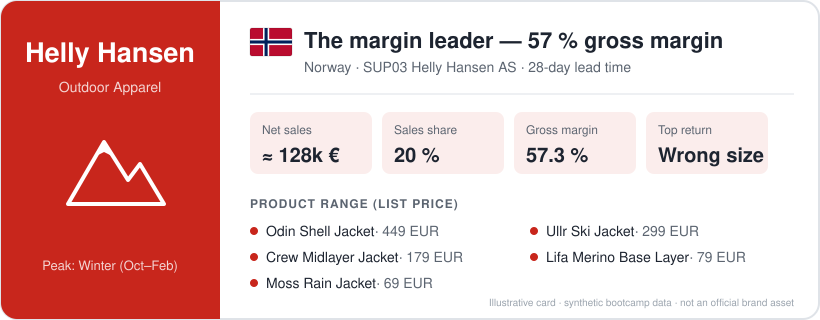

# 🏢 Nordhem Retail Group — Company Overview

> **🎯 Purpose:** business context for Genie One: who the company is, where it sells and where its data comes from.
> Table and column names refer to the Unity Catalog schema `retail_bootcamp.gold`.

| 🏷️ Label | Meaning |
|---|---|
| **[DATA]** | A fact you can check in the gold tables. Calculated from the bootcamp data (2024-01-01 → 2026-09-30). |
| **[POLICY]** | A company rule or business practice. It guides interpretation, but no table stores it, so Genie cannot check it with SQL. |

> ⚠️ Nordhem Retail Group is fictional and all data is synthetic. The brand names Electrolux, LEGO and Helly Hansen
> are used for realism only. No price, cost, volume or financial figure relates to the real companies. The brand
> cards in this document are illustrations, not official brand assets.

### ⚡ At a glance

| | |
|---|---|
| 🌍 **Markets** | Sweden, Norway, Denmark (three sales regions) |
| 🏬 **Channels** | 10 physical stores (ST01–ST10) + 1 web shop (ON01) |
| 🏷️ **Brands** | Electrolux · LEGO · Helly Hansen (15 products) |
| 👥 **Customers** | 200, of which 141 are loyalty members |
| 💶 **Net sales** | 650,801.55 EUR over 1,324 orders (Net Revenue after refunds: 604,798.15 EUR) |
| 📅 **As-of date** | **2026-09-30**. "Today", "this month" and "last 30 days" are relative to this date |
| 💱 **Currency** | All amounts in **EUR** |

---

## 1. 🏷️ Who we are — three Nordic brands

**[DATA]** Nordhem Retail Group is a multi-brand retailer in Scandinavia. It sells three Nordic brands, one from
each home market, through 10 physical stores and one web shop.



### 🔌 Electrolux — Home Appliances (Sweden)
- **Role:** the **revenue engine**. 62 % of net sales, high ticket (299–899 EUR), usually 1 unit per line.
- **Range:** 600 Series Dishwasher, 700 Series Washing Machine, Pure Q9 Cordless Vacuum, 800 Series Induction Hob,
  UltimateHome 500 Air Purifier.
- **Sub-categories:** Dishwashers, Laundry, Floor Care, Cooking, Air Care.
- **Peak:** Black Friday (November). **Supplier:** SUP01 Electrolux Nordic AB, 21-day lead time.
- **Watch-out:** lowest margin (37.7 %). Deep discounts hit it hardest (see the promotions document).



### 🧱 LEGO — Toys (Denmark)
- **Role:** the **gift brand**. 18 % of net sales, often 2–3 units per line.
- **Range:** Technic Supercar, City Fire Station, Friends Heartlake Cafe, Creator 3-in-1 Pirate Ship, Icons Flower Bouquet.
- **Sub-categories:** Construction Sets, Display Models.
- **Peak:** Christmas (December). **Supplier:** SUP02 LEGO Nordic A/S, 14-day lead time (the shortest).
- **Home market:** Denmark, where toy and Christmas promotions are expected to do best.



### 🏔️ Helly Hansen — Outdoor Apparel (Norway)
- **Role:** the **margin leader**. 20 % of net sales at 57.3 % gross margin.
- **Range:** Odin Shell Jacket, Ullr Ski Jacket, Crew Midlayer Jacket, Lifa Merino Base Layer, Moss Rain Jacket.
- **Sub-categories:** Shell Jackets, Midlayers, Base Layers, Rainwear, Ski Jackets.
- **Peak:** Winter (October–February). **Supplier:** SUP03 Helly Hansen AS, 28-day lead time (the longest).
- **Watch-out:** 47 % of all returned units. "Wrong size" is its biggest return reason.

### 🎁 Nordhem Services & Gifts — the common category
- **Role:** Nordhem's own house brand, sold as an extra line with **every brand, in every store and online**.
- **Range:** P016 Nordhem Gift Card (50 EUR) and P017 Nordhem Care & Protection Plan (39 EUR).
- **Governance:** the one category **every user can see** in their regions. It is added by
  `notebooks/2026-10-22-05-governance.py` and is **not** included in the [DATA] figures of this pack.
  See `2026-10-22-data-governance.md`.

### 📊 Brand economics [DATA] (all order lines, 2024-01 → 2026-09)

| Brand | Home country | Category (`dim_product.category`) | Net sales (EUR) | Share | Gross margin % (no promotion) | List price |
|---|---|---|---|---|---|---|
| 🔌 Electrolux | 🇸🇪 Sweden | Home Appliances | ≈ 404,000 | 62 % | 37.7 % | 299–899 EUR |
| 🏔️ Helly Hansen | 🇳🇴 Norway | Outdoor Apparel | ≈ 128,000 | 20 % | 57.3 % | 69–449 EUR |
| 🧱 LEGO | 🇩🇰 Denmark | Toys | ≈ 119,000 | 18 % | 47.8 % | 49–449 EUR |

> 💡 **Key insight:** Electrolux drives revenue. Helly Hansen and LEGO drive margin. Keep this in mind for discount
> decisions. See `2026-10-21-promotions-and-discounts.md`.

---

## 2. 🌍 Market regions and store network

**[DATA]** Each country is one sales region (`dim_store.region`, derived from `country_region`):

| Region | Country | Local currency [POLICY context] | Physical stores |
|---|---|---|---|
| 🧭 **Scandinavia East** | 🇸🇪 Sweden | SEK | ST01 Mall of Scandinavia (Stockholm), ST02 Gallerian Stockholm, ST03 Nordstan Gothenburg, ST04 Emporia Malmo |
| 🧭 **Scandinavia West** | 🇳🇴 Norway | NOK | ST05 Storo Oslo, ST06 Byporten Oslo, ST07 Lagunen Bergen |
| 🧭 **Scandinavia South** | 🇩🇰 Denmark | DKK | ST08 Fields Copenhagen, ST09 Stroget Copenhagen, ST10 Bruuns Galleri Aarhus |
| 🌐 (Online) | Run from Sweden | — | **ON01 Online Store**, shipped from warehouse WH01 |

> ⚠️ **Important [DATA]:** `ON01` has `country = 'Sweden'`, so its `region` is **Scandinavia East**. Any "sales by
> region" total for Scandinavia East therefore includes all online sales (≈ 207,500 EUR of ≈ 363,300 EUR).
> To compare regions fairly, filter `dim_store.channel = 'Store'`. See `2026-10-21-regional-methodology.md`.

### 📊 Net sales by channel and region [DATA]

| Region | Channel | Orders | Net sales (EUR) | Gross margin % | Avg order value (EUR) |
|---|---|---|---|---|---|
| Scandinavia East | 🌐 Online (ON01) | 431 | 207,500.10 | 41.4 % | 481.44 |
| Scandinavia East | 🏬 Store (4 stores) | 338 | 155,841.45 | 40.9 % | 461.07 |
| Scandinavia West | 🏬 Store (3 stores) | 274 | 150,511.80 | 39.9 % | 549.31 |
| Scandinavia South | 🏬 Store (3 stores) | 281 | 136,948.20 | 41.0 % | 487.36 |
| **Total** | | **1,324** | **650,801.55** | **40.8 %** | |

> 💡 Per physical store, **Norway sells the most** (≈ 50,200 EUR per store), ahead of Denmark (≈ 45,600) and
> Sweden (≈ 39,000). Norway also has the highest average order value, because it buys more Electrolux per order.

---

## 3. 🛍️ Channels

**[DATA]** `dim_store.channel` is either **Store** (ST01–ST10) or **Online** (ON01).

| | 🏬 Store | 🌐 Online |
|---|---|---|
| Share of orders | ≈ 67 % (893) | ≈ 33 % (431) |
| Order / line IDs | `POS-*` / `POSI-*` | `WEB-*` / `WEBI-*` |
| Customers | ≈ 90 % live in the store's country | From all three countries |
| Delivery | Taken home | PostNord, Bring, DHL Express or Budbee, **3-day promise** |
| Behaviour data | — | Sessions, device, traffic source and conversion in `fact_web_session` |

---

## 4. 👥 Customers and loyalty

**[DATA]** 200 customers: 🇸🇪 Sweden 80, 🇳🇴 Norway 62, 🇩🇰 Denmark 55, 🇫🇴 Faroe Islands 3 (region `Unassigned`).

| ⭐ Loyalty tier (`dim_customer.loyalty_tier`) | None | Bronze | Silver | Gold | Platinum |
|---|---|---|---|---|---|
| Customers | 59 | 65 | 46 | 21 | 9 |

**Customer segments** (`dim_customer.customer_segment`), calculated at 2026-09-30:

| Segment | Rule |
|---|---|
| 💎 **VIP** | Lifetime net sales ≥ 2,000 EUR, or Platinum tier |
| 🆕 **New** | Signed up within 180 days of 2026-09-30, or at most 1 order |
| 🙂 **Regular** | Everyone else |

**[POLICY]** Loyalty is a single Nordhem programme across all three countries. Points and tiers are shared by every
store and the web shop. A customer keeps their home region (`dim_customer.region`) wherever they shop.

---

## 5. 📅 Calendar and seasons

**[DATA]** `dim_date` covers 2024-01-01 → 2026-12-31 and defines:
- `season`: ❄️ Winter (Dec–Feb), 🌱 Spring (Mar–May), ☀️ Summer (Jun–Aug), 🍂 Autumn (Sep–Nov).
- `is_holiday`: only public holidays **shared by all three countries**, such as New Year, Easter, 1 May,
  Ascension, Whit Monday and Christmas. National days are **not** flagged. See the regional methodology.
- `is_weekend`: Saturday and Sunday. Weekend days sell about 30 % more than weekdays.

### 🗓️ Retail calendar [DATA + POLICY]

| Period | Dates | What happens |
|---|---|---|
| ❄️ Winter low | January–February | Lowest sales of the year |
| ⭐ Loyalty Spring Bonus | March–April (2025 only) | 5 % loyalty promotion (PR09) |
| ☀️ Summer Sale | mid-June → 31 July | 15 % clearance (PR03 / PR04 / PR08) |
| 🏔️ Winter Outdoor | October (2025) | 20 % "Winter Outdoor Week" (PR07); Helly Hansen season starts |
| 🛍️ Black Week | Last week of November | Black Friday promotion (20 % in 2024, 25 % in 2025). Highest daily sales of the year |
| 🎄 Christmas | Early December → 23 December | 10 % Christmas Gift Deal; LEGO peak |

---

## 6. 🗄️ Data sources and lineage

**[DATA]** Nordhem's data comes from **10 source systems** covering **9 business domains**. They deliver
**27 CSV extracts** into the landing volume `/Volumes/retail_bootcamp/landing/raw_files/<entity>/`. The data then flows
through three layers:

```
 10 source systems           🥉 BRONZE                    🥈 SILVER                   🥇 GOLD
 (27 CSV extracts)  ──►  bronze.<code>_<entity>_raw  ──►  silver.<entity>  ──►  6 dimensions + 6 facts
                         all STRING, untouched          typed, cleaned,         star schema used by
                         + _source_system,              de-duplicated,          Genie and the metric
                           _source_file, _ingest_ts     invalid lines           view gold.kpi_metrics
                                                        quarantined
```

### 6.1 🧭 Domain map

| # | Source system | Code | Business domain | What it answers | Feeds gold |
|---|---|---|---|---|---|
| 1 | 🧑‍🤝‍🧑 **CRM** | `crm` | Customer | Who our customers are, where they live, loyalty status | `dim_customer` |
| 2 | 🛒 **E-commerce platform** | `ecom` | Digital sales | What happens in the web shop: visits, carts, online orders | `fact_web_session`, `fact_order_line` (ON01) |
| 3 | 🏬 **POS (point of sale)** | `pos` | Store sales | What was sold at the tills of the 10 stores | `fact_order_line` (ST01–ST10) |
| 4 | 🏭 **ERP** | `erp` | Product and procurement | What we sell, from whom, and what we buy | `dim_product`, `dim_supplier` |
| 5 | 📦 **WMS (warehouse management)** | `wms` | Inventory and logistics | How much stock is where, and how parcels are delivered | `fact_inventory_daily`, `fact_shipment` |
| 6 | 💳 **Payment gateway** | `pay` | Payments | How customers paid, and what was refunded | — (silver only) |
| 7 | ↩️ **Returns portal** | `rtn` | After-sales | What came back, why, and how much was refunded | `fact_returns` |
| 8 | 📣 **Marketing** | `mkt` | Promotions and campaigns | Which discounts ran and what media supported them | `dim_promotion` |
| 9 | 💰 **Finance GL** | `fin` | Finance | Booked P&L and budget per store and month | `fact_finance_monthly` |
| 10 | 🗂️ **Master data (MDM)** | `mdm` | Reference data | The official list of stores, channels and regions | `dim_store` (+ region on `dim_customer`) |

> 🧩 `dim_date` has no source system. It is generated in the gold notebook (2024-01-01 → 2026-12-31, with shared holidays).

### 6.2 📋 Source by source

Row counts are **raw** rows in the CSV extracts, so they include the injected duplicates and invalid rows.

#### 1 · 🧑‍🤝‍🧑 CRM — Customer domain
The customer relationship system holds every registered customer and the loyalty programme.

| Extract | Raw rows | Key columns | What one row is |
|---|---|---|---|
| `customers` | 206 | customer_id, first/last name, email, phone, gender, date_of_birth, country, city, signup_date, is_active | One registered customer (200 after de-duplication) |
| `customer_addresses` | 247 | address_id, customer_id, address_type (Home 200, Delivery 47), street, postal_code, city, country | One address of a customer |
| `loyalty_members` | 141 | member_id, customer_id, loyalty_tier, points_balance, enrolled_date | One loyalty membership; customers without a row are tier `None` |

- 🥇 **Gold:** `dim_customer` (customer + loyalty tier + region + segment + age group).
- 🧹 **Data-quality fixes in silver:** 6 duplicate rows removed; extra spaces and mixed casing trimmed; signup dates in
  `dd.MM.yyyy` parsed; native country names (Sverige, Norge, Danmark) mapped to English; Faroe Islands customers
  get region `Unassigned`.
- ℹ️ `customer_addresses` stays in bronze. Gold uses the city and country on the customer record.

#### 2 · 🛒 E-commerce platform — Digital sales domain
The web shop platform logs every visit and every online order for ON01.

| Extract | Raw rows | Key columns | What one row is |
|---|---|---|---|
| `web_sessions` | 5,010 | session_id, customer_id (NULL = anonymous), session_start_ts, device, traffic_source, pages_viewed, added_to_cart_flag, ordered_flag | One web visit (5,000 after de-duplication) |
| `cart_events` | 2,222 | event_id, session_id, event_ts, product_id, event_type (add_to_cart 1,729, remove_from_cart 493), quantity | One click in the basket |
| `online_orders` | 431 | order_id (`WEB-*`), order_ts, customer_id, session_id, promotion_id, order_status, payment_method | One online order |
| `online_order_items` | 648 | order_item_id (`WEBI-*`), order_id, product_id, quantity, unit_price, discount_amount | One line of an online order |

- 🥇 **Gold:** `fact_web_session` (funnel and conversion) and the **Online** rows of `fact_order_line` (`store_id = 'ON01'`).
- 🧹 **Data-quality fixes in silver:** 10 duplicate sessions removed; 4 order lines with quantity 0 quarantined.
- ℹ️ `cart_events` stays in bronze. The add-to-cart signal in gold is `added_to_cart_flag`.

#### 3 · 🏬 POS — Store sales domain
The till system of the 10 physical stores.

| Extract | Raw rows | Key columns | What one row is |
|---|---|---|---|
| `store_orders` | 895 | order_id (`POS-*`), order_ts, store_id, customer_id, promotion_id, order_status, payment_method | One till receipt |
| `store_order_items` | 1,361 | order_item_id (`POSI-*`), order_id, product_id, quantity, unit_price, discount_amount | One line on a receipt |

- 🥇 **Gold:** the **Store** rows of `fact_order_line` (ST01–ST10). Silver merges POS and e-commerce orders into one
  model with a `channel` column.
- 🧹 **Data-quality fixes in silver:** 8 duplicate lines removed; 4 lines with quantity 0 and 2 orders from the unknown
  customer `C9999` (3 lines) moved to `silver.order_items_quarantine` with a `reject_reason`. That leaves
  893 store orders + 431 online orders = **1,324 orders** in gold.

#### 4 · 🏭 ERP — Product and procurement domain
The enterprise resource planning system is the master for the product catalogue and supplier purchasing.

| Extract | Raw rows | Key columns | What one row is |
|---|---|---|---|
| `products` | 17 | product_id, sku, product_name, brand, category_id, supplier_id, list_price, unit_cost, launch_date, is_active | One product (15 after de-duplication) |
| `product_categories` | 12 | category_id, category_name, sub_category_name | One category / sub-category pair |
| `suppliers` | 3 | supplier_id, supplier_name, country, lead_time_days, payment_terms_days | One supplier, one per brand |
| `purchase_orders` | 317 | po_id, supplier_id, product_id, order_date, expected_date, received_date, qty_ordered, qty_received, unit_cost | One replenishment order to a supplier |

- 🥇 **Gold:** `dim_product` (with category, sub-category and supplier name) and `dim_supplier` (with lead time).
- 🧹 **Data-quality fixes in silver:** 2 duplicate product rows removed.
- ℹ️ `purchase_orders` is cleaned into silver but not modelled in gold. Use it for supplier on-time questions only
  if it is added to the Genie space.
- 💡 `unit_cost` is the standard cost used for COGS and gross profit.

#### 5 · 📦 WMS — Inventory and logistics domain
The warehouse management system tracks stock in the 10 stores and the central warehouse WH01, and ships online orders.

| Extract | Raw rows | Key columns | What one row is |
|---|---|---|---|
| `inventory_snapshots` | 14,850 | snapshot_date, product_id, location_id, on_hand_qty, reserved_qty, reorder_point | End-of-day stock of one product at one location (90 days × 15 products × 11 locations) |
| `inventory_movements` | 11,772 | movement_id, movement_ts, product_id, location_id, movement_type (Sale 11,047, Receipt 562, Adjustment 163), quantity | One stock movement |
| `shipments` | 431 | shipment_id, order_id, warehouse_id, ship_date, delivery_date, carrier, shipping_cost, delivery_status | One parcel for one online order |

- 🥇 **Gold:** `fact_inventory_daily` (warehouse WH01 reported as `ON01`, `is_stock_out` when available ≤ 0) and
  `fact_shipment` (`delivery_days`, `is_on_time` against the 3-day promise).
- ⚠️ Stock data covers only **2026-07-03 → 2026-09-30**. Stock is a snapshot, so never sum it across dates.
- ℹ️ `inventory_movements` stays in bronze.

#### 6 · 💳 Payment gateway — Payments domain
The payment service provider records every captured payment and every refund.

| Extract | Raw rows | Key columns | What one row is |
|---|---|---|---|
| `payments` | 1,329 | payment_id, order_id, payment_ts, amount, payment_method, payment_status (Captured) | One payment for one order (1,324 after de-duplication) |
| `refunds` | 159 | refund_id, return_id, payment_id, refund_ts, amount, refund_status (Processed) | One refund for one return |

- 🥇 **Gold:** none directly. `fact_order_line.payment_method` comes from the order, and refund amounts come from the
  returns portal (`fact_returns.refund_amount`).
- 🧹 **Data-quality fixes in silver:** 5 duplicate payments removed.
- 💡 Payment methods show local preferences: **Swish** 🇸🇪, **Vipps** 🇳🇴, **MobilePay** 🇩🇰, and **Klarna** online only.

#### 7 · ↩️ Returns portal — After-sales domain
Customers register returns here, for both store and online purchases.

| Extract | Raw rows | Key columns | What one row is |
|---|---|---|---|
| `returns` | 159 | return_id, order_item_id, return_date, return_qty, refund_amount, return_reason | One returned order line |

- 🥇 **Gold:** `fact_returns`, linked to the original sale through `order_item_id` and dated by **return date**.
- 💡 159 returns, 175 units, 46,003.40 EUR refunded. Net Revenue = net sales − these refunds.

#### 8 · 📣 Marketing — Promotions and campaigns domain
The marketing planning tool holds the discount rules and the media campaigns behind them.

| Extract | Raw rows | Key columns | What one row is |
|---|---|---|---|
| `promotions` | 9 | promotion_id, promotion_name, promotion_type, discount_pct, start_date, end_date, campaign_id | One discount offer (PR01–PR09) |
| `campaigns` | 8 | campaign_id, campaign_name, media_mix, start_date, end_date, budget_eur | One media campaign with its budget |

- 🥇 **Gold:** `dim_promotion`, plus a `PR00 No promotion` row so every order line joins.
- ℹ️ Campaign budgets stay in bronze (`bronze.mkt_campaigns_raw`). The promotions document lists them.

#### 9 · 💰 Finance GL — Finance domain
The general ledger is the accounting record of booked revenue, costs and budget.

| Extract | Raw rows | Key columns | What one row is |
|---|---|---|---|
| `gl_entries` | 2,178 | entry_id, posting_date, account_code, account_type (Revenue, COGS, Operating Expense), cost_centre, store_id, amount | One monthly posting for one store |
| `budgets` | 1,089 | month, store_id, account_type, budget_amount | One budget line per month, store and account type |
| `cost_centres` | 22 | cost_centre, cost_centre_name, store_id, department (Operations, Marketing) | One cost centre (2 per store) |

- 🥇 **Gold:** `fact_finance_monthly` (33 months × 11 stores, actuals vs budget).
- ⚠️ GL revenue is **booked** store revenue. **Never add it to, or compare it with, order-line net sales.**
- ℹ️ `cost_centres` stays in bronze.

#### 10 · 🗂️ Master data (MDM) — Reference data domain
The master data hub owns the shared reference lists that every other system uses.

| Extract | Raw rows | Key columns | What one row is |
|---|---|---|---|
| `stores` | 11 | store_id, store_name, channel_id, country, city, opening_date | One store or the online channel |
| `channels` | 2 | channel_id, channel_name, description | Store or Online |
| `country_region` | 3 | country_code, country_name, region | SE → East, NO → West, DK → South |

- 🥇 **Gold:** `dim_store` (channel and region added). `country_region` also gives `dim_customer.region`.
- ⚠️ The Faroe Islands are not in `country_region`, so those customers get region `Unassigned`.

### 6.3 🔗 Lineage summary — from source to gold

| 🥇 Gold table | Built from (source → extract) |
|---|---|
| `dim_customer` | CRM customers + CRM loyalty_members + MDM country_region + (POS + e-commerce orders for segment) |
| `dim_product` | ERP products + ERP product_categories + ERP suppliers |
| `dim_supplier` | ERP suppliers |
| `dim_store` | MDM stores + MDM channels + MDM country_region |
| `dim_promotion` | Marketing promotions (+ PR00) |
| `dim_date` | Generated in the gold notebook |
| `fact_order_line` | POS store orders/items + e-commerce online orders/items + ERP products (unit cost) |
| `fact_returns` | Returns portal returns + `fact_order_line` |
| `fact_web_session` | E-commerce web_sessions |
| `fact_inventory_daily` | WMS inventory_snapshots |
| `fact_shipment` | WMS shipments |
| `fact_finance_monthly` | Finance GL gl_entries + budgets |
| 📐 `kpi_metrics` (metric view) | `fact_order_line`, `fact_returns`, `fact_web_session`, `fact_inventory_daily`, `fact_finance_monthly`, `dim_store` |

> ℹ️ **Not in gold:** customer_addresses, cart_events, inventory_movements, purchase_orders, payments, refunds,
> campaigns and cost_centres. Genie cannot answer questions that need them unless those tables are added to the space.
> Say so instead of guessing.

---

## 7. 📚 Related documents

| Document | Use it for |
|---|---|
| 🌍 `2026-10-21-regional-methodology.md` | How we compare and report Sweden, Norway and Denmark |
| 🏷️ `2026-10-21-promotions-and-discounts.md` | Promotion types, discount calculation, lift and ROI methods |
| 📊 `2026-10-21-kpi-methodology.md` | Every KPI formula, grain and validated value |
| 🔁 `2026-10-21-returns-inventory-fulfilment.md` | Returns, stock, delivery, loyalty and P&L operations |
| 🔐 `2026-10-22-data-governance.md` | Who can see which region, category and table |
